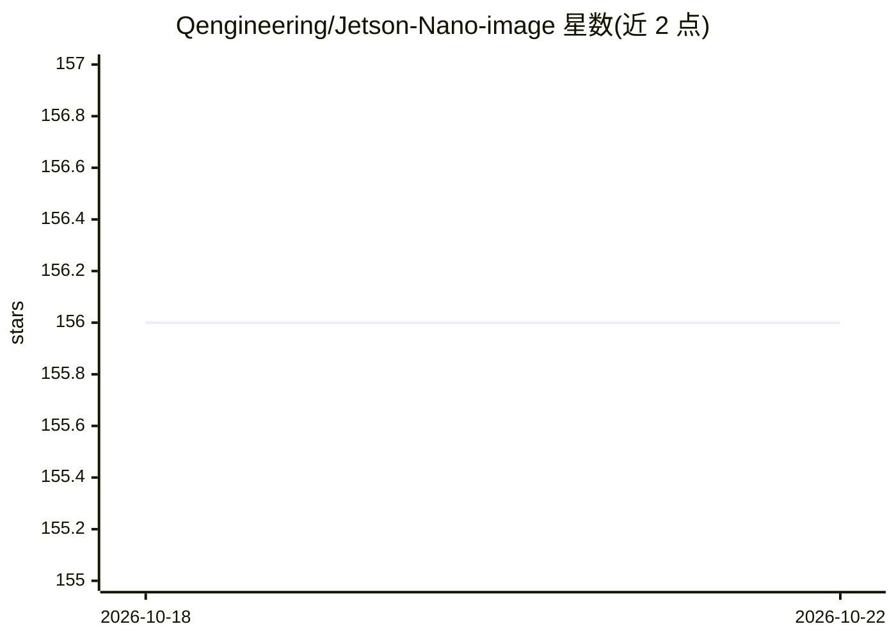

# Qengineering/Jetson-Nano-image

⭐ 156 · BSD-3-Clause · 推送 2026-07-23 · [GitHub](https://github.com/Qengineering/Jetson-Nano-image) · [官网](https://qengineering.eu/install-tensorflow-2.4.0-on-jetson-nano.html) · 个人维护

**Jetson Nano 预装深度学习框架的 SD 卡系统镜像**

面向 Jetson Nano（4GB RAM）的系统镜像文件：刷入 32GB SD 卡后即得到预装 JetPack 4.6.0、OpenCV 4.5.3、TensorFlow 2.4.1、PyTorch 1.8.1、TorchVision、LibTorch、ncnn、MNN、JTOP 与 TeamViewer（aarch64）的运行环境。安装方式为下载 7.2GB 的 img.xz 镜像并用 balenaEtcher 等工具烧录。限制：因 CUDA 11 无法安装在 Jetson Nano 上，TensorFlow 停留在 2.4.1 版本；README 另记录 TensorFlow 与 OpenCV 同时导入的 TLS 内存问题及规避方法。

## 筛选速览

| 维度 | 判定 | 备注 |
|---|---|---|
| AI 角色 | `ai-ecosystem` | LLM/agent 周边工具 |
| 许可风险 | `permissive` | BSD-3-Clause |
| 部署形态 | `None` |  |
| 模型依赖 | — | README 未给出锁定关系 |
| 硬件要求 | — | 无带数字的原话,不猜 |
| 安装摩擦 | `medium` | 含编译或系统依赖之一 |
| 成熟度 | — | 结构信号不足 |

## 能力要点

- 预装 OpenCV/TensorFlow/PyTorch/ncnn/MNN 等框架的即用镜像
- JetPack 4.6.0 环境下 TensorFlow 2.4.1（CUDA 11 不可装的约束）
- 含 OpenCV+TensorFlow 同导入内存错误的说明与规避方案

## 适用场景

- 在 Jetson Nano 上快速获得深度学习开发环境而无需自行编译
- 为边缘设备部署准备预装 ncnn/MNN 的推理环境

## 场景标签

 · 领域:嵌入式/边缘 AI 开发环境

## 证据(README 行号)

> L3: ## A Jetson Nano image with OpenCV, TensorFlow and Pytorch
> L27: - JetPack 4.6.0
> L39: TensorFlow 2.5 and above require CUDA 11. CUDA version 11 cannot be installed on a Jetson Nano due to incompatibili

## 星数曲线

2026-10-18 156 → 2026-10-22 156（+0）

---
*卡片 v1 · prompt 1.4 · 生成 2026-10-22 · 置信度 high · 依据 README sha `80d5b6e37dfc` · [字段定义](../../DATASET.md)*
