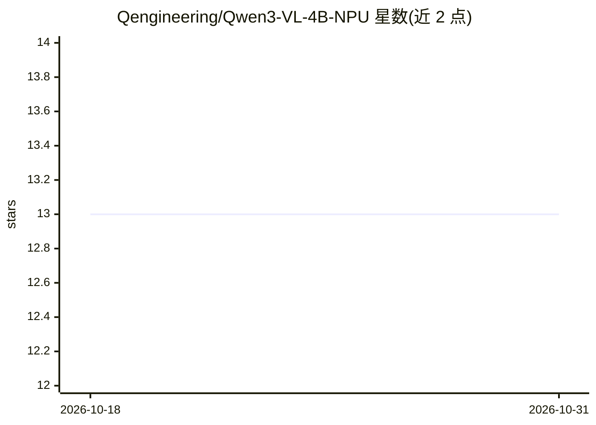

# Qengineering/Qwen3-VL-4B-NPU

⭐ 13 · C++ · BSD-3-Clause · 推送 2026-07-22 · [GitHub](https://github.com/Qengineering/Qwen3-VL-4B-NPU) · [官网](https://qengineering.eu/deep-learning-examples-on-raspberry-32-64-os.html) · 个人维护

**在 RK3588 NPU 上运行 Qwen3-VL-4B 的 C++ 图像对话应用**

面向 Rock 5C / Orange Pi 5 等 RK3588 单板机的 C++ 应用，将 Qwen3-VL-4B 的语言模型（w8a8 量化 rkllm）与视觉编码器（fp16 rknn）加载到 NPU 上运行，实现图像+文本的多轮对话，附 token 速率与内存基准表。需下载约 5.4GB 模型文件，依赖 rkllm-runtime 1.2.3 与 rknpu 驱动 0.9.8（仓库附带），并安装 OpenCV；用 CMake 或 Code::Blocks 从源码编译。限制：RK3588 版本不匹配会导致 BPE 解析错位故障。

## 筛选速览

| 维度 | 判定 | 备注 |
|---|---|---|
| AI 角色 | `ai-native` | 本体是模型或模型工具 |
| 许可风险 | `permissive` | BSD-3-Clause |
| 部署形态 | `None` |  |
| 模型依赖 | — | README 未给出锁定关系 |
| 硬件要求 | — | 无带数字的原话,不猜 |
| 安装摩擦 | `medium` | 含编译或系统依赖之一 |
| 成熟度 | — | 结构信号不足 |

## 能力要点

- Qwen3-VL-4B 在 RK3588 NPU 上运行（LLM w8a8 / 视觉编码器 fp16）
- 提供 16 个模型在 RK3588 上的 tokens/s 与内存基准表
- 支持多轮对话（<image>/<clear>/<exit> 令牌控制）
- 提供 CMake 与 Code::Blocks 两种构建方式

## 适用场景

- 在 RK3588 单板机上离线进行图像问答
- 评估边缘设备上多模态模型的内存与速度表现
- 作为 RKLLM/RKNN NPU 编程的 C++ 参考实现

## 场景标签

`多模态` · 领域:感知与多模态

## 证据(README 行号)

> L13: ## Qwen3-4B VLM for RK3588 NPU (Rock 5, Orange Pi 5).
> L29: Once converted to RKNN, parts of the model can run on the NPU, improving speed.
> L131: VLM_NPU Picture RKNN_model RKLLM_model NewTokens ContextLength

## 星数曲线

2026-10-18 13 → 2026-10-31 13（+0）

---
*卡片 v1 · prompt 1.4 · 生成 2026-10-31 · 置信度 high · 依据 README sha `3d23e45c7596` · [字段定义](../../DATASET.md)*
