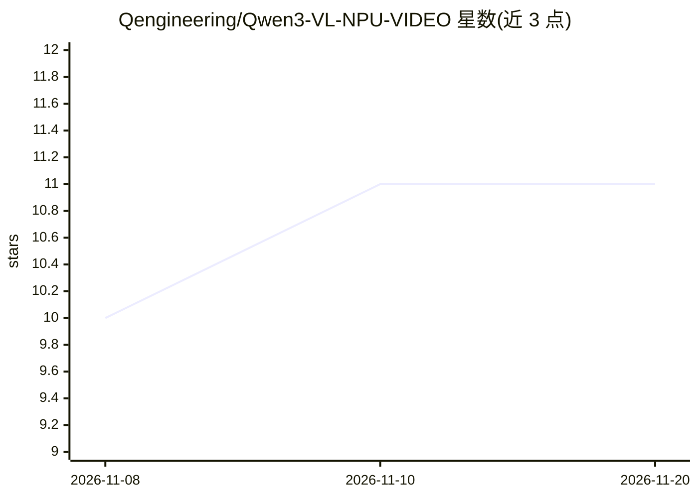

# Qengineering/Qwen3-VL-NPU-VIDEO

⭐ 11 · C++ · BSD-3-Clause · 推送 2026-02-16 · [GitHub](https://github.com/Qengineering/Qwen3-VL-NPU-VIDEO) · [官网](https://qengineering.eu/deep-learning-examples-on-raspberry-32-64-os.html) · 组织维护

**在 RK3588 NPU 上运行 Qwen3-VL 描述视频的 C++ 应用**

面向 Rock 5/Orange Pi 5 等 RK3588 开发板的视频理解应用：将视频抽帧后，用 RKNN 格式的视觉编码器把每帧转为 vision token，再交给 RKLLM 格式的量化 LLM 生成对视频的自然语言描述，并支持多轮对话（<image>/<clear>/<exit> 控制符）。RKLLM 限制 4092 token，每个 vision token 约占 200 token/20MB RAM，因此视频最多处理 20 帧、默认抽 8 帧。需 CMake 或 Code::Blocks 编译，依赖 OpenCV、rkllm、rknn 库。

## 筛选速览

| 维度 | 判定 | 备注 |
|---|---|---|
| AI 角色 | `ai-native` | 本体是模型或模型工具 |
| 许可风险 | `permissive` | BSD-3-Clause |
| 部署形态 | `None` |  |
| 模型依赖 | — | README 未给出锁定关系 |
| 硬件要求 | — | 无带数字的原话,不猜 |
| 安装摩擦 | `high` | 编译与系统依赖俱全 |
| 成熟度 | — | 结构信号不足 |

## 能力要点

- 视频抽帧→RKNN 视觉编码→RKLLM 量化的本地推理流程
- 附 Qwen3/InternVL3.5/SmolVLM2 多模型的 FPS 与内存基准表
- 支持视频（mp4/avi/mov/mkv）与多张图片两种输入模式
- 提供运行在 Rock 5C 上的在线演示 Rock5GPT

## 适用场景

- 在 RK3588 开发板上离线生成视频内容描述
- 对多张图片进行视觉问答与多轮对话
- 评估不同小型 VLM 在 NPU 上的运行速度与内存占用

## 场景标签

`多模态` · 领域:感知与多模态

## 证据(README 行号)

> L34: To process video input, individual frames are first extracted. The VLM converts each frame into embeddings, which a
> L90: To run InternVL3, you need to have the **rkllm-runtime** library version **1.2.3** (or higher) installed, as well a

## 星数曲线

2026-11-08 10 → 2026-11-20 11（+1）

---
*卡片 v1 · prompt 1.4 · 生成 2026-11-18 · 置信度 high · 依据 README sha `b9c7b1b2198c` · [字段定义](../../DATASET.md)*
