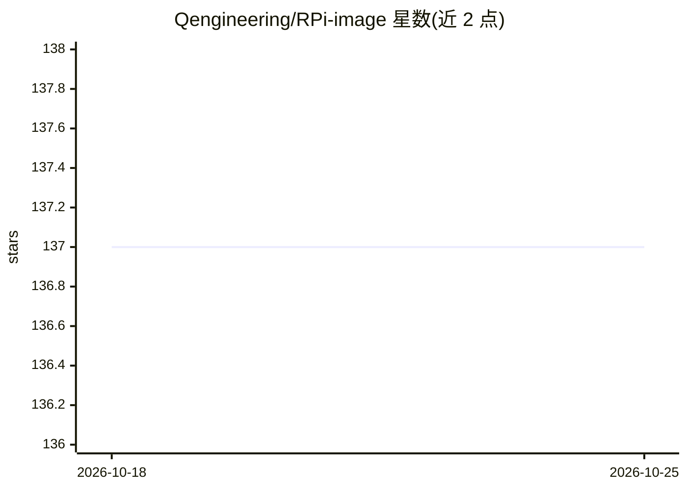

# Qengineering/RPi-image

⭐ 137 · BSD-3-Clause · 推送 2026-07-23 · [GitHub](https://github.com/Qengineering/RPi-image) · [官网](https://qengineering.eu/deep-learning-examples-on-raspberry-32-64-os.html) · 个人维护

**预装深度学习框架与示例的树莓派 4 64 位系统镜像**

面向 Raspberry Pi 4 的 Debian 10 Buster 64 位操作系统镜像（2.68 GByte，可扩展至 SD 卡全容量）：出厂预装 OpenCV 4.5.1、ncnn、MNN、Paddle-Lite、TensorFlow/TensorFlow-Lite 2.4.1、PyTorch 1.8.0 等 8 个深度学习框架，并附带分类、SSD 检测、分割、姿态估计、人脸检测与识别等示例工程，均链接到维护者的 GitHub 仓库与安装指南。用户使用 balenaEtcher 等工具烧录到 16 GB 以上 SD 卡即可启动；默认未启用 WiFi，附启用步骤与 OpenCV/TensorFlow 共存的 TLS 内存问题 workaround。

## 筛选速览

| 维度 | 判定 | 备注 |
|---|---|---|
| AI 角色 | `ai-ecosystem` | LLM/agent 周边工具 |
| 许可风险 | `permissive` | BSD-3-Clause |
| 部署形态 | `None` |  |
| 模型依赖 | — | README 未给出锁定关系 |
| 硬件要求 | — | 无带数字的原话,不猜 |
| 安装摩擦 | `low` | 无编译、无系统依赖或容器化 |
| 成熟度 | — | 结构信号不足 |

## 能力要点

- 预装 OpenCV/ncnn/MNN/Paddle-Lite/TensorFlow/PyTorch 等 8 个深度学习框架
- 附带分类、检测、分割、姿态估计、人脸识别等示例工程
- PiShrink 压缩后镜像 2.68 GByte，烧录后自动扩展至 SD 卡容量

## 适用场景

- 在树莓派 4 上跳过繁琐编译直接获得可用深度学习环境
- 运行计算机视觉示例（人脸识别、姿态估计、目标检测）
- 按预装框架的安装指南复现环境搭建过程

## 场景标签

`人脸识别` `目标检测` · 领域:感知与多模态

## 证据(README 行号)

> L3: ## A Raspberry Pi 4 Buster 64-bit OS image with deep-learning examples
> L49: ## Pre-installed frameworks.
> L53: - OpenCV 4.5.1

## 星数曲线

2026-10-18 137 → 2026-10-25 137（+0）

---
*卡片 v1 · prompt 1.4 · 生成 2026-10-22 · 置信度 high · 依据 README sha `958aa626214e` · [字段定义](../../DATASET.md)*
