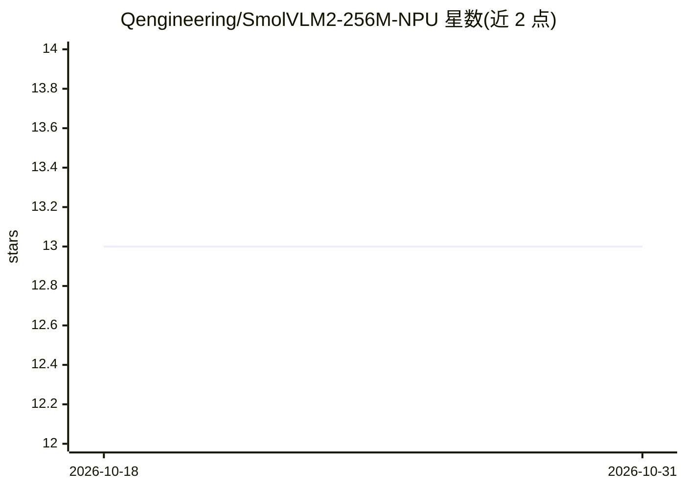

# Qengineering/SmolVLM2-256M-NPU

⭐ 13 · C++ · BSD-3-Clause · 推送 2026-07-25 · [GitHub](https://github.com/Qengineering/SmolVLM2-256M-NPU) · [官网](https://qengineering.eu/deep-learning-examples-on-raspberry-32-64-os.html) · 个人维护

**在 RK3588 NPU 上运行 SmolVLM2-256M 的视觉语言模型推理应用**

面向 RK3588（Rock 5、Orange Pi 5）NPU 的 C++ 视觉语言模型部署工程：将 SmolVLM2-256M 的视觉编码器（fp16 RKNN）与语言模型（w8a8 RKLLM）在 NPU 上运行，支持图像+文本多轮对话，256M 模型约 0.5GB 内存、54 tokens/s。需自行编译：依赖 OpenCV、rkllm-runtime 1.2.3 与 rknpu 驱动 0.9.8（版本不匹配会导致 BPE 解析错位），模型文件从 Hugging Face 下载（约 400MB）。README 说明小模型输出质量有限，并附 15 个模型在该 NPU 上的基准表。

## 筛选速览

| 维度 | 判定 | 备注 |
|---|---|---|
| AI 角色 | `ai-native` | 本体是模型或模型工具 |
| 许可风险 | `permissive` | BSD-3-Clause |
| 部署形态 | `None` |  |
| 模型依赖 | — | README 未给出锁定关系 |
| 硬件要求 | — | 无带数字的原话,不猜 |
| 安装摩擦 | `medium` | 含编译或系统依赖之一 |
| 成熟度 | — | 结构信号不足 |

## 能力要点

- SmolVLM2-256M 视觉编码器 fp16 + LLM w8a8 量化在 NPU 上运行
- 基准表：256M 模型 0.5GB 内存、54 tokens/s（含 Qwen/InternVL 等 15 个模型对比数据）
- 命令行多轮对话，支持 <image>/<clear>/<exit> 控制符
- 仓库内置指定版本的 rkllm/rknn 库文件

## 适用场景

- 在 Rock 5 / Orange Pi 5 板卡上离线做图像描述与问答
- 评估小型 VLM 在 RK3588 NPU 上的速度与内存开销
- 作为 Rockchip NPU 部署多模态模型的参考工程

## 场景标签

`多模态` · 领域:感知与多模态

## 证据(README 行号)

> L10: ## SmolVLM2-256M VLM for RK3588 NPU (Rock 5, Orange Pi 5).
> L125: VLM_NPU Picture RKNN_model RKLLM_model NewTokens ContextLength
> L143: VLM_NPU ./Moon.jpg ./models/smolvlm2_256m_vision_fp16_rk3588.rknn ./models/smolvlm2-256m-video-instruct_w8a8_rk358

## 星数曲线

2026-10-18 13 → 2026-10-31 13（+0）

---
*卡片 v1 · prompt 1.4 · 生成 2026-10-31 · 置信度 high · 依据 README sha `0735a6729a0c` · [字段定义](../../DATASET.md)*
