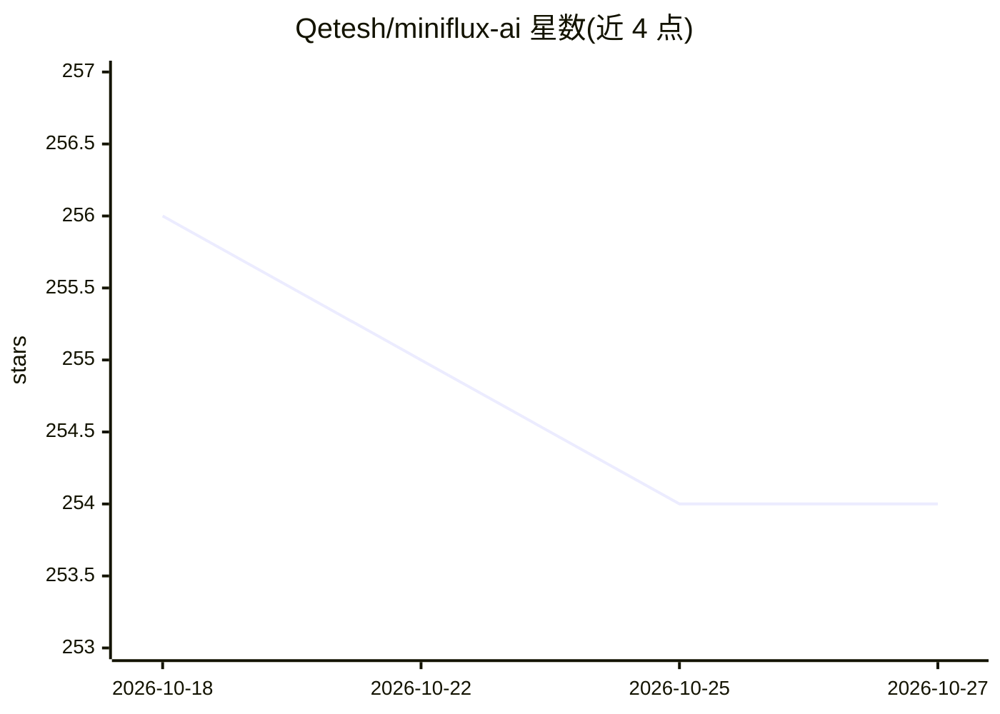

# Qetesh/miniflux-ai

⭐ 254 · Python · 推送 2026-06-22 · [GitHub](https://github.com/Qetesh/miniflux-ai) · 个人维护

**为 Miniflux RSS 阅读器生成 AI 摘要、翻译与 AI 新闻的工具**

通过 Miniflux API 或 Webhook 获取未读 RSS 条目，调用 LLM（如 Ollama、OpenAI 兼容接口）生成摘要与翻译，并可按计划生成 AI 早晚报，结果写回 Miniflux 条目内容。Agent 通过 config.yml 定义，可配置 prompt、allow_list/deny_list 过滤与 Markdown/HTML 输出样式。要求 Python 3.11+、Miniflux API Key 与 OpenAI 兼容的 LLM API Key；提供 docker-compose 部署，也可直接 python main.py 运行。FAQ 记录了 Miniflux 2.2.18 起访问私网需设置环境变量。

## 筛选速览

| 维度 | 判定 | 备注 |
|---|---|---|
| AI 角色 | `ai-native` | 本体是模型或模型工具 |
| 许可风险 | `none` | — |
| 部署形态 | `self-host` | docker 或自建部署 |
| 模型依赖 | local-ok | 支持本地模型 |
| 硬件要求 | — | 无带数字的原话,不猜 |
| 安装摩擦 | `low` | 无编译、无系统依赖或容器化 |
| 成熟度 | — | 结构信号不足 |

## 能力要点

- 从 Miniflux 拉取未读条目或经 Webhook 触发 LLM 处理
- 基于 feed 内容按计划生成 AI 早晚报
- config.yml 自定义 agent：prompt、allow/deny 过滤、输出样式
- 支持 Markdown 与样式化 HTML 块输出

## 适用场景

- 给 RSS 订阅条目自动生成摘要和翻译
- 让 LLM 汇总订阅源生成每日 AI 新闻
- 配合自托管 Miniflux 做 AI 增强阅读

## 场景标签

`AI 写作` · 领域:内容生成

## 证据(README 行号)

> L4: This project integrates with Miniflux to fetch RSS feed content via API or webhook. It then utilizes large language 
> L10: - **LLM Processing**: Generate summaries, translations, etc. based on your chosen LLM agent.

## 星数曲线

2026-10-18 256 → 2026-10-27 254（-2）

---
*卡片 v1 · prompt 1.4 · 生成 2026-10-22 · 置信度 mid · 依据 README sha `f3a0df7f3423` · [字段定义](../../DATASET.md)*
