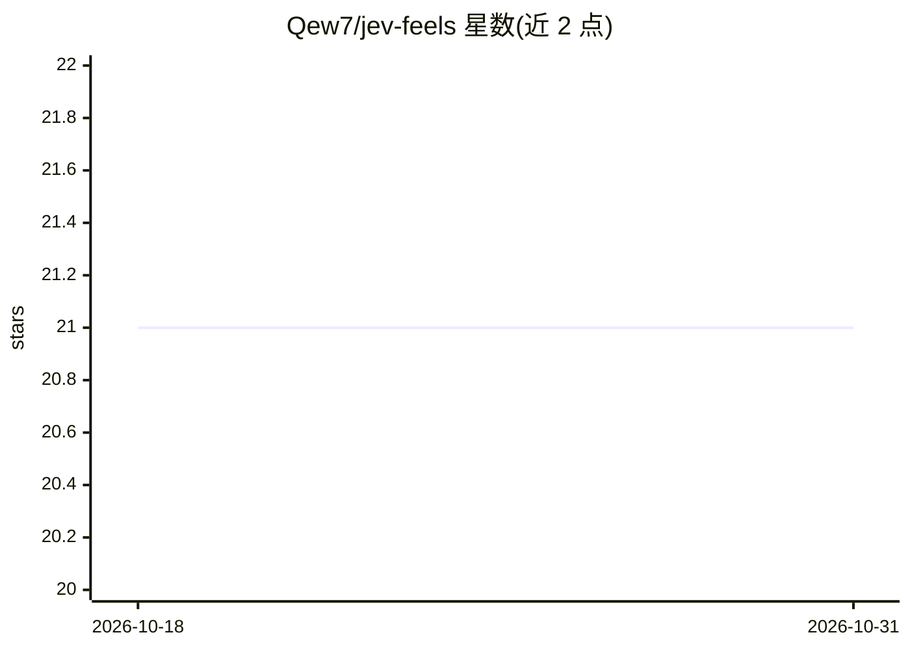

# Qew7/jev-feels

⭐ 21 · Ruby · MIT · 推送 2026-10-12 · [GitHub](https://github.com/Qew7/jev-feels) · 个人维护

**Ruby gem：用 #feels?/#decide/#score 做语义判定与 Rails 校验**

面向 Ruby/Rails 开发者的语义判定库：通过 Jev.define 声明词表（是/否检查、最多 255 项的 decide 决策、2-10 级的 score 量表），在字段或字符串上调用 feels?/decide/score 获得概率、类别或分数；支持 Rails validates_feeling 校验、PORO 绑定、String refinement、批量单请求、模式匹配分发（Jev.match），以及测试用的 stub 与录制/回放磁带（回放不走网络）。语义调用依赖 Jev / TypeSafe System One API（默认 api.typesafe.ai），需配置 JEV_API_KEY。

## 筛选速览

| 维度 | 判定 | 备注 |
|---|---|---|
| AI 角色 | `ai-ecosystem` | LLM/agent 周边工具 |
| 许可风险 | `permissive` | MIT |
| 部署形态 | `None` |  |
| 模型依赖 | — | README 未给出锁定关系 |
| 硬件要求 | — | 无带数字的原话,不猜 |
| 安装摩擦 | `low` | 无编译、无系统依赖或容器化 |
| 成熟度 | — | 结构信号不足 |

## 能力要点

- Jev.define 词表：是/否检查、最多 255 选项的 decide、2-10 级 score 量表
- Rails validates_feeling 校验与 allow_nil/if/on 等标准选项
- threshold/at_least/confidence 三种不确定性控制，中间带返回 nil
- 测试支持：按定义名 stub、录制真实回答后离线回放，磁带不存 API key

## 适用场景

- 在 Rails 模型校验中做语义判定（如邮件是否紧急、是否垃圾）
- 客服工单按语义分派到支持团队并做严重度评分
- 用模式匹配按语义决策路由业务逻辑，测试中离线回放固定回答

## 场景标签

`语义搜索` · 领域:知识与检索

## 证据(README 行号)

> L261: Jev / TypeSafe System One. `POST https://api.typesafe.ai/v1/systemone`. That is an implementation detail. The publ
> L237:   config.api_key = ENV["JEV_API_KEY"]

## 星数曲线

2026-10-18 21 → 2026-10-31 21（+0）

---
*卡片 v1 · prompt 1.4 · 生成 2026-10-28 · 置信度 high · 依据 README sha `d30df8c23fb8` · [字段定义](../../DATASET.md)*
