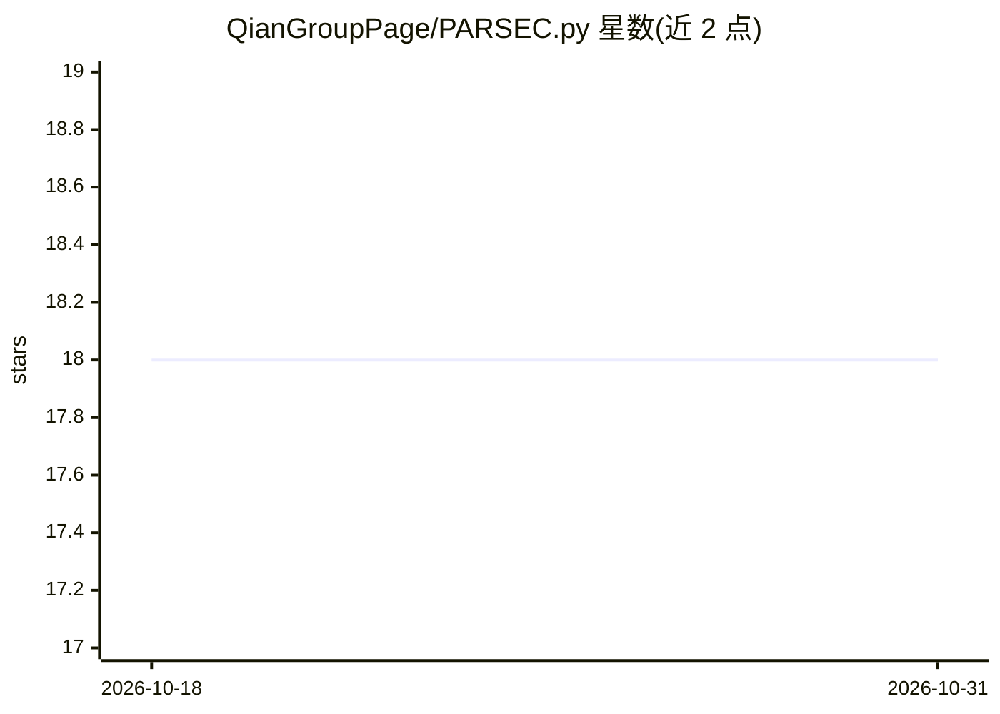

# QianGroupPage/PARSEC.py

⭐ 18 · Python · NOASSERTION · 推送 2026-10-30 · [GitHub](https://github.com/QianGroupPage/PARSEC.py) · [官网](https://onlinelibrary.wiley.com/doi/10.1002/jcc.70482) · 组织维护

**Python 实现的孤立体系实空间 Kohn-Sham DFT 求解器**

以 PARSEC Fortran 代码算法为基础的原生 Python 实现的实空间 Kohn-Sham DFT 求解器，直接读取 PARSEC 风格 parsec.in 输入文件与 *_POTRE.DAT 范数守恒赝势，运行时不调用 PARSEC、MPI 或 Fortran。同一命令可在 CPU 或 NVIDIA GPU（经 CuPy）上运行，可选 C++/OpenMP 原生扩展与多 GPU 对称扇区划分；描述中声明采用机器学习电荷密度加速。面向计算化学/材料领域科研用户，仓库描述引用 J. Comput. Chem. 论文。

## 筛选速览

| 维度 | 判定 | 备注 |
|---|---|---|
| AI 角色 | `ai-enhanced` | 去掉 AI 部分产品仍成立 |
| 许可风险 | `none` | NOASSERTION |
| 部署形态 | `library` | 以包/库形式分发 |
| 模型依赖 | — | README 未给出锁定关系 |
| 硬件要求 | `cpu-ok` | |
| 安装摩擦 | `high` | 编译与系统依赖俱全 |
| 成熟度 | — | 结构信号不足 |

## 能力要点

- 原生 Python 实现，运行时不需要 PARSEC Fortran 可执行文件或 MPI
- 同一命令支持 CPU/CUDA GPU，默认 auto 自动选择可用设备
- 可选 C++/OpenMP 原生扩展与多 GPU（CuPy）加速，backend 可指定 scipy/native/cupy
- 支持 Slurm 等集群调度器环境，按作业可见资源分配

## 适用场景

- 运行孤立分子/团簇的实空间 DFT 计算，复用已有 PARSEC 输入文件与赝势
- 在单机 CPU 或多 GPU（含集群）上执行 SCF 电子结构计算
- 通过 --dry-run 校验输入、按 backend 对比不同实现的结果

## 场景标签

 · 领域:计算化学/电子结构（DFT）

## 证据(README 行号)

> L3: PARSEC.py is a native Python implementation of isolated, real-space
> L4: Kohn--Sham DFT based on the algorithms in the PARSEC Fortran code. It reads
> L97: The same command runs on a CPU and on a GPU. By default (`--device auto`) it

## 星数曲线

2026-10-18 18 → 2026-10-31 18（+0）

---
*卡片 v1 · prompt 1.4 · 生成 2026-10-29 · 置信度 low · 依据 README sha `e2c2929942f5` · [字段定义](../../DATASET.md)*
