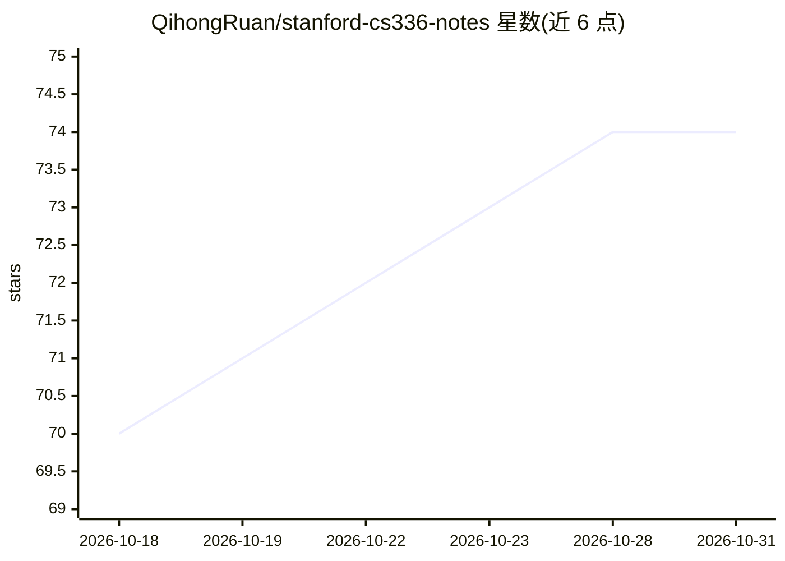

# QihongRuan/stanford-cs336-notes

⭐ 74 · HTML · 推送 2026-07-12 · [GitHub](https://github.com/QihongRuan/stanford-cs336-notes) · 个人维护

**斯坦福 CS336 课程的图解学习笔记站（17 讲）**

对 Stanford CS336（Spring 2025）Language Modeling from Scratch 课程的非官方整理笔记：覆盖分词、Transformer 架构、MoE、GPU 与 Triton 内核、并行策略、缩放定律、推理、评测、数据与对齐（SFT/RLHF/RL）。每讲含约 200 张幻灯片截图、LaTeX 公式与源视频链接，另有 26 篇算法深挖问答与 5 个课程作业的学习指南（指引而非答案）。笔记由视频与转录自动生成并编译为静态站点，作者声明可能含错误。课程内容版权归 Stanford。

## 筛选速览

| 维度 | 判定 | 备注 |
|---|---|---|
| AI 角色 | `ai-knowledge` | 知识聚合/清单类 |
| 许可风险 | `none` | — |
| 部署形态 | `None` |  |
| 模型依赖 | — | README 未给出锁定关系 |
| 硬件要求 | — | 无带数字的原话,不猜 |
| 安装摩擦 | `low` | 无编译、无系统依赖或容器化 |
| 成熟度 | — | 结构信号不足 |

## 能力要点

- 17 讲全部覆盖，含约 200 张幻灯片截图与公式渲染
- 26 篇算法深挖问答（BPE 复杂度、FlashAttention、PPO/DPO/GRPO 等）
- 5 个实现型课程作业的学习指南与陷阱提示
- 由视频与转录自动生成的静态站点，源码为 Markdown

## 适用场景

- 学习 LLM 从零构建的完整流程后快速复习或查阅
- 在做 CS336 作业前了解难点与切入方法
- 作为分词、并行、缩放定律等专题的推导参考

## 场景标签

`教程课程` · 领域:学习与行业

## 证据(README 行号)

> L3: Comprehensive, illustrated lecture notes for **Stanford CS336 (Spring 2025)** — *"Language Modeling from Scratch"*, 
> L14: - **Comprehensive written notes** — covering tokenization, Transformer architectures, Mixture-of-Experts, GPUs & Tr

## 星数曲线

2026-10-18 70 → 2026-10-31 74（+4）

---
*卡片 v1 · prompt 1.4 · 生成 2026-10-24 · 置信度 high · 依据 README sha `13c0b520fe4e` · [字段定义](../../DATASET.md)*
