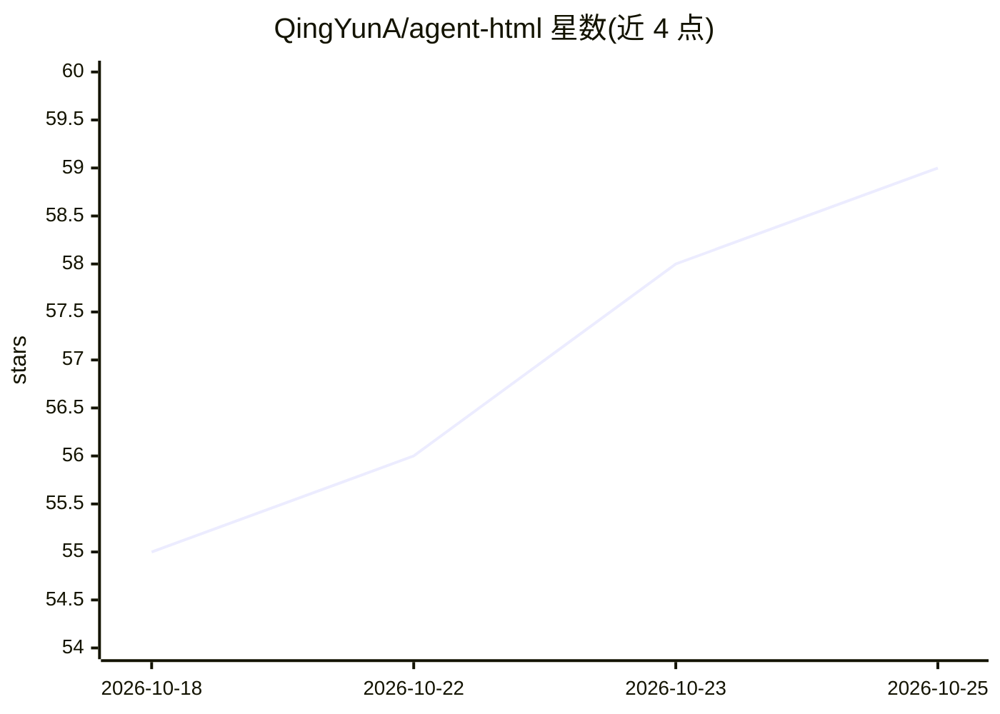

# QingYunA/agent-html

⭐ 59 · HTML · 推送 2026-09-29 · [GitHub](https://github.com/QingYunA/agent-html) · [官网](https://agent-html-bice.vercel.app) · 个人维护 · 中文 README

**零依赖单文件 HTML 设计系统，作为编码 agent 技能供 LLM 使用**

面向 Claude Code、Cursor、Pi、Codex 等编码 agent 的技能包与设计系统：提供约 75 行原生 CSS token（shadcn/ui 的 CSS 变量移植）、7 种单文件 HTML 布局原型（报告/仪表盘/检查器/对比/时间线/看板/代码评审）及原子组件库（按钮、32 个 SVG 图标、8 种零 CDN 纯 SVG 图表），使 LLM 生成离线可运行的单文件 HTML。含验证脚本 scripts/validate.mjs 与 12 个评测用例，通过 npx skills 或 git clone 安装，MIT 许可。

## 筛选速览

| 维度 | 判定 | 备注 |
|---|---|---|
| AI 角色 | `ai-ecosystem` | LLM/agent 周边工具 |
| 许可风险 | `none` | — |
| 部署形态 | `library` | 以包/库形式分发 |
| 模型依赖 | locked-api |  |
| 硬件要求 | — | 无带数字的原话,不猜 |
| 安装摩擦 | `low` | 无编译、无系统依赖或容器化 |
| 成熟度 | — | 结构信号不足 |

## 能力要点

- 7 种单文件 HTML 布局原型（报告/仪表盘/看板/评审等）
- 零 npm、零 CDN、100% 离线运行
- 8 种纯 SVG 图表与 32 个 currentColor 矢量图标
- 内置验证脚本 scripts/validate.mjs 与 12 个评测用例

## 适用场景

- 让编码 agent 生成离线可打开的单文件 HTML 仪表盘或报告
- 在隔离网络环境（无 CDN）下产出可视化交付物
- 为 PR 评审、模型对比等场景生成结构化单页 HTML

## 场景标签

`代码生成` · 领域:编码与开发

## 证据(README 行号)

> L5:  Zero-dependency, single-file HTML design system & agent skill for LLMs.
> L7:  Optimized for Claude Code, Pi, Codex, and Cursor.
> L46: Install directly into your coding agent (Claude Code, Cursor, Pi, Codex, Copilot, etc.) with zero manual cloning:

## 星数曲线

2026-10-18 55 → 2026-10-25 59（+4）

---
*卡片 v1 · prompt 1.4 · 生成 2026-10-24 · 置信度 high · 依据 README sha `f5dd75b8b9e7` · [字段定义](../../DATASET.md)*
