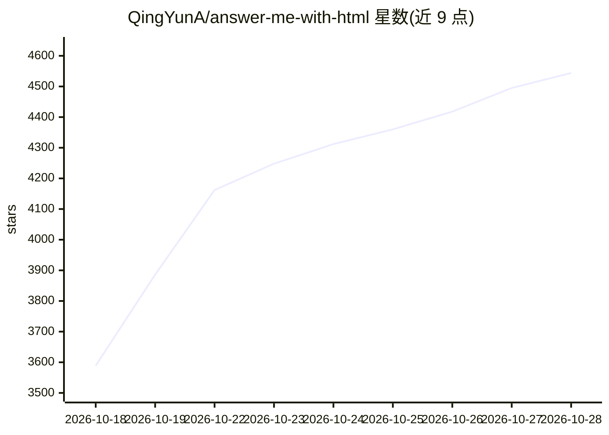

# QingYunA/answer-me-with-html

⭐ 4,544 · JavaScript · MIT · 推送 2026-10-27 · [GitHub](https://github.com/QingYunA/answer-me-with-html) · [官网](https://answer-me-with-html.com/) · 个人维护 · 中文 README

**让 AI Agent 用一页可读 HTML 回答复杂问题的技能**

面向 Claude Code、Codex、Cursor、OpenCode 等 agent 的技能插件：模型只写一份简短 Markdown 草稿，随技能附带的 CLI（约 50 ms）负责模板选择、面板布局、主题与图表坐标绘制，生成单文件离线 HTML 页面。README 给出 token 统计：模型仅需手写 HTML 约 1/8 的输出。附带 CLI 由 Node.js 20+ 运行，支持 3b1b 风格讲解视频、三套主题、always-on 模式与中/英/日界面。更新为手动，页面堆积在 ~/.answer-me-with-html/ 下可用 am clean 清理。

## 筛选速览

| 维度 | 判定 | 备注 |
|---|---|---|
| AI 角色 | `ai-ecosystem` | LLM/agent 周边工具 |
| 许可风险 | `permissive` | MIT |
| 部署形态 | `library` | 以包/库形式分发 |
| 模型依赖 | locked-api |  |
| 硬件要求 | — | 无带数字的原话,不猜 |
| 安装摩擦 | `medium` | 含编译或系统依赖之一 |
| 成熟度 | — | 结构信号不足 |

## 能力要点

- 模型只写 Markdown 草稿，CLI 负责布局与 SVG 坐标绘制，输出约为手写 HTML 1/8 的 token
- 单文件离线 HTML 页面，无 CDN 与网络字体依赖
- 3b1b 风格讲解视频生成（浏览器内编码导出，MP4 需 ffmpeg）
- 三套主题（blueprint/shadcn/paper）与中简/中繁/英/日界面

## 适用场景

- 让 agent 把复杂解释输出为带时序图、流程图的页面而不是长段文字
- 整理仓库模块结构或做技术选型对比的可视化回答
- 生成 3Blue1Brown 风格的讲解视频

## 场景标签

`视频生成` · 领域:内容生成

## 证据(README 行号)

> L9:  An agent skill. Ask a hard question, get a page you can actually read instead of a wall of text. The model writes a
> L64: Paste this into Claude Code, Codex, Cursor, OpenCode or any other agent:
> L180: So Answer me with HTML takes that work away from the model. The model writes content. The CLI handles layout, colo

## 星数曲线

2026-10-18 3,589 → 2026-10-28 4,544（+955）

---
*卡片 v1 · prompt 1.4 · 生成 2026-10-20 · 置信度 high · 依据 README sha `a104f5054e61` · [字段定义](../../DATASET.md)*
