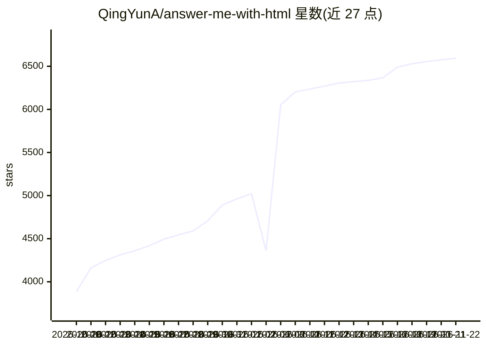

# QingYunA/answer-me-with-html

⭐ 6,593 · JavaScript · MIT · 推送 2026-11-20 · [GitHub](https://github.com/QingYunA/answer-me-with-html) · [官网](https://answer-me-with-html.com/) · 个人维护 · 中文 README

**让 AI Agent 用一页可读 HTML 回答复杂问题的技能**

一个可安装到 Claude Code、Codex、Cursor 等 agent 的技能：模型只需写约 1/8 的 Markdown 草稿，随技能附带的 CLI 负责模板选择、面板布局、主题、SVG 坐标与流程图排布，生成含序列图、状态图、对比表、代码等的一页 HTML，存于 ~/.answer-me-with-html/pages/。支持 always-on 模式让每条结论附带页面，可生成带旁白的解释视频（导出 MP4 需 ffmpeg）。运行需 Node.js 20+，无需 npm install 步骤。

## 筛选速览

| 维度 | 判定 | 备注 |
|---|---|---|
| AI 角色 | `ai-native` | 本体是模型或模型工具 |
| 许可风险 | `permissive` | MIT |
| 部署形态 | `library` | 以包/库形式分发 |
| 模型依赖 | — | README 未给出锁定关系 |
| 硬件要求 | — | 无带数字的原话,不猜 |
| 安装摩擦 | `medium` | 含编译或系统依赖之一 |
| 成熟度 | — | 结构信号不足 |

## 能力要点

- 模型只写 Markdown 草稿，SVG/CSS/HTML 由 CLI 生成，输出 token 约为手写 HTML 的 1/8
- 支持序列图、流程图、时间线、对比表等多种面板，布局由 dagre 等计算得出
- 草稿有错时 CLI 返回行号与正确示例，agent 可一次修正
- 可生成 3b1b 风格解释视频，WebM 在浏览器内编码无需 ffmpeg

## 适用场景

- 让 agent 解释多步流程或多概念问题并产出可视化页面
- 技术选型对比（如缓存方案）得到带结论的比较表页
- 为复杂主题生成可离线播放的分步讲解视频

## 场景标签

`AI 写作` · 领域:内容生成

## 证据(README 行号)

> L19:  An agent skill. Ask a hard question, get a page you can actually read instead of a wall of text. The model writes 
> L38: The agent writes a short Markdown draft and hands it to the CLI that ships with the skill. About 50 ms later you ha

## 星数曲线

2026-10-20 3,886 → 2026-11-22 6,593（+2,707）

---
*卡片 v1 · prompt 1.4 · 生成 2026-11-22 · 置信度 high · 依据 README sha `e1e286c419ff` · [字段定义](../../DATASET.md)*
