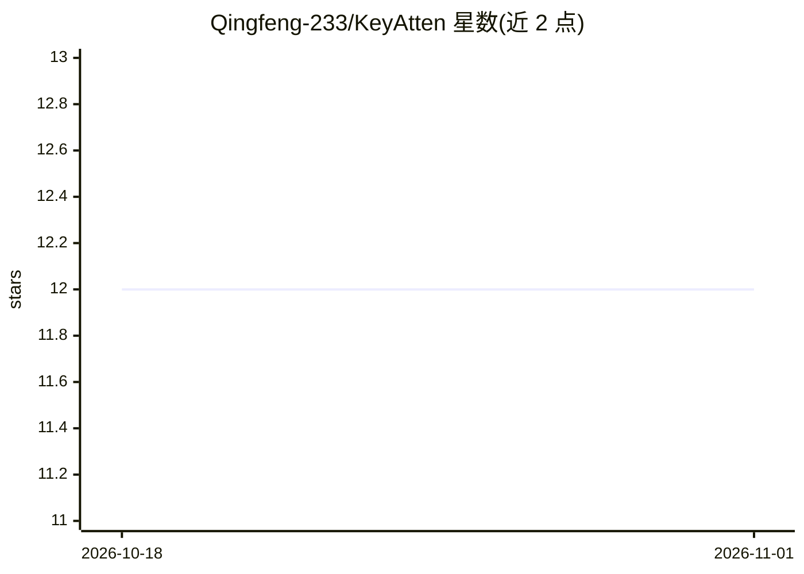

# Qingfeng-233/KeyAtten

⭐ 12 · Python · MIT · 推送 2026-10-29 · [GitHub](https://github.com/Qingfeng-233/KeyAtten) · 个人维护 · 中文 README

**开发者用 Transformer 注意力做中英文关键词/关键短语抽取的库**

KeyAtten 是一个 Python 关键词抽取库，从 Transformer 注意力权重计算候选词得分，支持中文与英文。基础路径无需训练与标注，单次前向传播完成抽取；需要更高精度时可选用 BIO 候选、LoRA 重排序等已训练路线。提供 7 种注意力打分方法及乘以 TF-IDF 的 _idf 变体，支持 torch 与 ONNX Runtime 两种后端，兼容 HF 模型（如 gte-small-zh、MiniLM、Qwen3-Embedding）。在 7 个公开数据集上与 TF-IDF、TextRank、KeyBERT 等 14 种方法对比并给出 F1@10 结果。

## 筛选速览

| 维度 | 判定 | 备注 |
|---|---|---|
| AI 角色 | `ai-native` | 本体是模型或模型工具 |
| 许可风险 | `permissive` | MIT |
| 部署形态 | `library` | 以包/库形式分发 |
| 模型依赖 | — | README 未给出锁定关系 |
| 硬件要求 | — | 无带数字的原话,不猜 |
| 安装摩擦 | `low` | 无编译、无系统依赖或容器化 |
| 成熟度 | — | 结构信号不足 |

## 能力要点

- 零训练零标注的基础路径，单次前向传播完成抽取
- 7 种注意力打分方法（received_attn/cls_attn/samrank 等）及 TF-IDF 混合变体
- 支持 torch 与 ONNX Runtime 后端，轻量中文模型约 33M 参数
- 提供 BIO 候选与 LoRA 重排序等已训练抽取器路线

## 适用场景

- 从中文或英文文档中零样本抽取关键词与关键短语
- 在无 GPU 环境用 ONNX Runtime 轻量部署关键词抽取
- 对语料批量建立 IDF 状态后做更精准的关键词打分

## 场景标签

 · 领域:NLP/文本挖掘

## 证据(README 行号)

> L7: Keyword / keyphrase extraction from Transformer attention, for Chinese and English. The base route needs no training
> L43: |`KeyAttenExtractor`|No|Default; zero-shot attention scoring|

## 星数曲线

2026-10-18 12 → 2026-11-01 12（+0）

---
*卡片 v1 · prompt 1.4 · 生成 2026-11-01 · 置信度 high · 依据 README sha `c7ef600414ac` · [字段定义](../../DATASET.md)*
