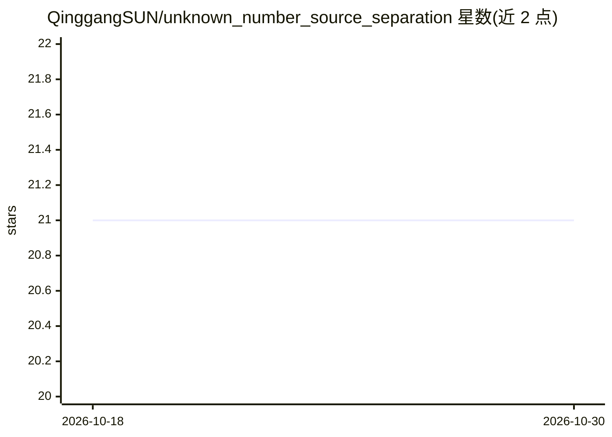

# QinggangSUN/unknown_number_source_separation

⭐ 21 · Python · MIT · 推送 2025-12-16 · [GitHub](https://github.com/QinggangSUN/unknown_number_source_separation) · 个人维护

**未知数量水下船舶辐射噪声的单通道声源分离代码**

论文官方代码：基于自编码器神经网络对未知数量信源的单通道水下声学信号做分离，后端为 keras 2.2.4 + tensorflow-gpu 1.12.0。使用 ShipsEar 数据库（需向作者邮件获取），按 README 给出的数据目录组织文件、安装 requirements.txt 依赖后，运行多个预处理脚本，再执行 7 组实验脚本（多自编码器、多输出自编码器、算法 1-3、FUSS、CBIR 基线）。供科研复现论文实验使用。

## 筛选速览

| 维度 | 判定 | 备注 |
|---|---|---|
| AI 角色 | `ai-native` | 本体是模型或模型工具 |
| 许可风险 | `permissive` | MIT |
| 部署形态 | `None` |  |
| 模型依赖 | — | README 未给出锁定关系 |
| 硬件要求 | — | 无带数字的原话,不猜 |
| 安装摩擦 | `low` | 无编译、无系统依赖或容器化 |
| 成熟度 | — | 结构信号不足 |

## 能力要点

- 未知数量信源的单通道水下声源分离（自编码器）
- 配套 arXiv:2207.11749 论文的官方代码
- 提供 7 组实验脚本含 FUSS 与 CBIR 基线复现

## 适用场景

- 复现论文中未知数量信源分离算法
- 在水下声学信号处理研究中对比分离方法
- 基于 ShipsEar 数据集开展船舶噪声分离实验

## 场景标签

`科研工具` · 领域:学习与行业

## 证据(README 行号)

> L2: Underwater single-channel acoustic source separation with unknown numbers using autoencoder nerual networks. Using k
> L7: @misc{sun2022source,

## 星数曲线

2026-10-18 21 → 2026-10-30 21（+0）

---
*卡片 v1 · prompt 1.4 · 生成 2026-10-28 · 置信度 high · 依据 README sha `9f132d57c6f0` · [字段定义](../../DATASET.md)*
