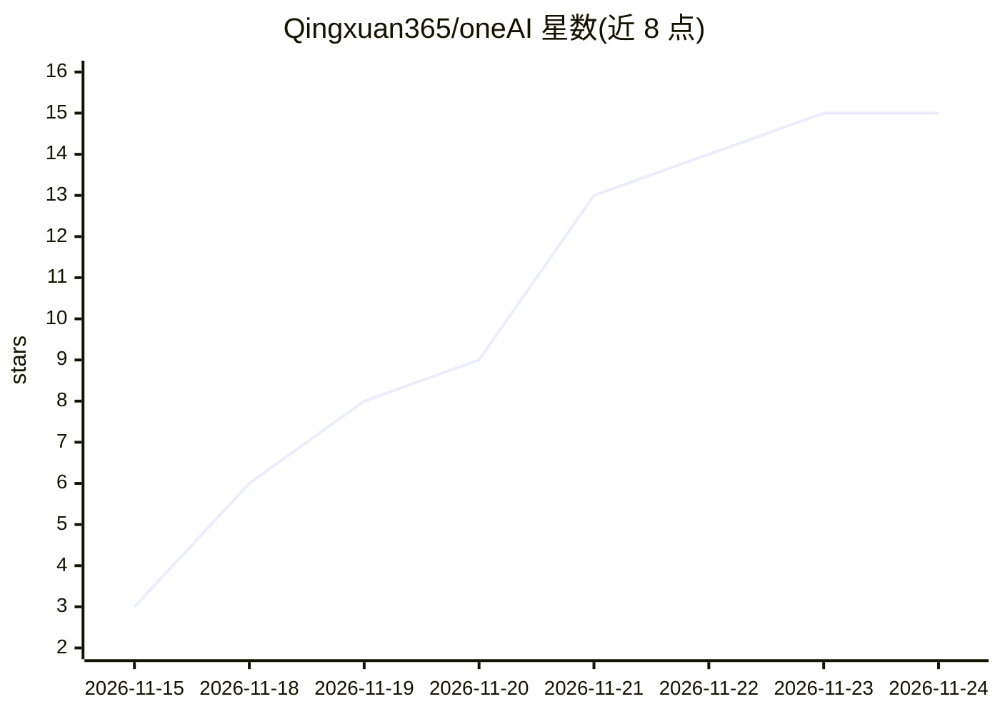

# Qingxuan365/oneAI

⭐ 15 · TypeScript · MIT · 推送 2026-11-21 · [GitHub](https://github.com/Qingxuan365/oneAI) · 个人维护 · 中文 README

**在单一桌面窗口并排运行多个 AI 编码 CLI 的工作台**

基于 Electron 31 的 Windows 桌面应用，把 Codex、Claude Code、Kimi Code、OpenCode 等多个 AI 编码 CLI 集中到一个侧边栏，按项目文件夹分组，每个 CLI 运行在独立持久终端（xterm.js + Windows ConPTY）中，切换任务不中断进程。提供配额与用量的顶栏实时显示、多账号并行（以配置目录+环境变量实现，不读取凭据）、按 CLI/账号/模型的周用量统计、会话历史浏览与恢复、文件只读预览。CLI 从 PATH 自动检测，未listed的可自定义添加；扩展功能依赖各 CLI 本地会话格式。

## 筛选速览

| 维度 | 判定 | 备注 |
|---|---|---|
| AI 角色 | `ai-ecosystem` | LLM/agent 周边工具 |
| 许可风险 | `permissive` | MIT |
| 部署形态 | `desktop` | 安装包/桌面程序 |
| 模型依赖 | — | README 未给出锁定关系 |
| 硬件要求 | — | 无带数字的原话,不猜 |
| 安装摩擦 | `low` | 无编译、无系统依赖或容器化 |
| 成熟度 | — | 结构信号不足 |

## 能力要点

- 持久终端：切换任务/文件夹不结束进程（node-pty/ConPTY）
- 顶栏实时显示 tokens、费用、5h/7d 限额与活动模型
- 多账号并行运行，凭据由用户自行管理，应用不读取
- 19 个已知 CLI 自动检测，支持自定义 CLI 接入

## 适用场景

- 同时使用多个 AI 编码 CLI 并集中管理终端会话
- 多个账号并行跑任务并跟踪各自配额用量
- 按项目文件夹组织后台编码任务并查看状态

## 场景标签

`编码 Agent` · 领域:编码与开发

## 证据(README 行号)

> L11: OneAI runs Codex, Claude Code, Kimi Code, OpenCode and other AI coding CLIs side by side, each in its own real term
> L33: OneAI looks up these commands on your `PATH` at startup and offers the ones it finds. The list lives in `src/main/k
> L49: OneAI currently runs on **Windows 10 / 11 (x64)**, because it relies on the Windows ConPTY API. The AI CLIs themsel

## 星数曲线

2026-11-15 3 → 2026-11-24 15（+12）

---
*卡片 v1 · prompt 1.4 · 生成 2026-11-20 · 置信度 high · 依据 README sha `4f153bef7d1c` · [字段定义](../../DATASET.md)*
