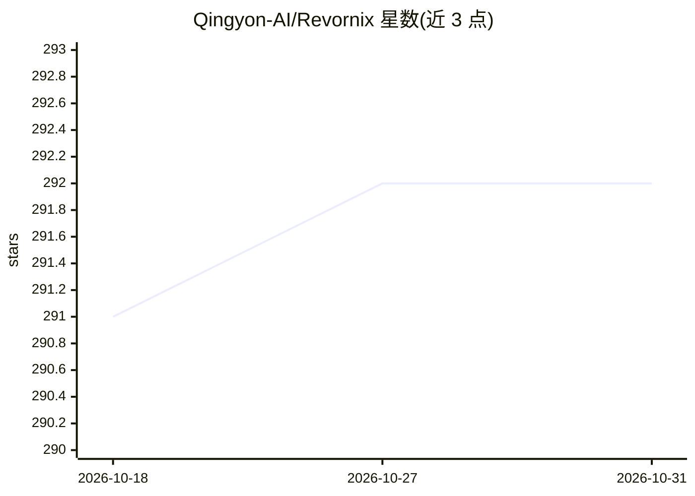

# Qingyon-AI/Revornix

⭐ 292 · TypeScript · NOASSERTION · 推送 2026-09-22 · [GitHub](https://github.com/Qingyon-AI/Revornix) · [官网](https://revornix.com) · 组织维护 · 中文 README

**个人与团队的自托管 AI 信息工作台：收集内容并生成知识与播客**

Revornix 是可自托管的本地优先 AI 信息工作台，面向个人与团队收集网页、论文、音频、截图等输入。内容被清洗为 Markdown，向量化写入 Milvus，并抽取实体关系到 Neo4j 个人图谱；提供基于文档与图谱的聊天、摘要、插图报告、双语音播客和通知。支持接入 OpenAI 兼容提供方，解析、嵌入、摘要等引擎可替换；默认使用云端嵌入，本地 torch 嵌入为可选。

## 筛选速览

| 维度 | 判定 | 备注 |
|---|---|---|
| AI 角色 | `ai-native` | 本体是模型或模型工具 |
| 许可风险 | `none` | NOASSERTION |
| 部署形态 | `self-host` | docker 或自建部署 |
| 模型依赖 | — | README 未给出锁定关系 |
| 硬件要求 | — | 无带数字的原话,不猜 |
| 安装摩擦 | `low` | 无编译、无系统依赖或容器化 |
| 成熟度 | — | 结构信号不足 |

## 能力要点

- 多格式摄取：网页、PDF、Word、Excel、PPT、文本、音频与结构化数据
- Milvus 向量检索与 Neo4j 个人知识图谱构成 GraphRAG 能力
- 生成 AI 摘要、插图报告、双语音播客，并通过邮件/应用/推送通知
- 既是 MCP 客户端也是 MCP 服务器，可接入 OpenAI 兼容提供方

## 适用场景

- 我把刷不完的链接、论文和音频先存起来，之后读结构化摘要和每日汇总
- 基于我自己的文档和个人知识图谱提问，得到有上下文的回答
- 把文档或专题转成双语音播客，处理完成后通过通知渠道接收
- 把知识板块私有共享给团队，或发布到公共社区页

## 场景标签

`知识库管理` `知识图谱` `文档问答` · 领域:知识与检索

## 证据(README 行号)

> L13: Revornix is an open-source, local-first AI information workspace. Save the noisy stream of links, papers, audio and
> L29: - **Built for AI retrieval quality** — chunked vector storage in Milvus paired with a personalized GraphRAG layer o
> L70: - **AI assistant (Revornix AI)** — chat that grounds on your documents and the personal graph.

## 星数曲线

2026-10-18 291 → 2026-10-31 292（+1）

---
*卡片 v1 · prompt 1.4 · 生成 2026-10-22 · 置信度 high · 依据 README sha `ab09845c79de` · [字段定义](../../DATASET.md)*
