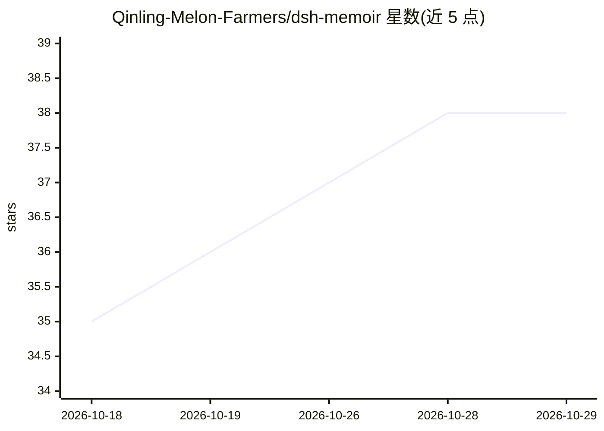

# Qinling-Melon-Farmers/dsh-memoir

⭐ 38 · TypeScript · Apache-2.0 · 推送 2026-10-19 · [GitHub](https://github.com/Qinling-Melon-Farmers/dsh-memoir) · [官网](https://www.npmjs.com/package/dsh-memoir) · 组织维护 · 中文 README

**DeepSeek Harness 的本地跨会话项目记忆插件**

面向 DSH（DeepSeek Harness）的 npm 插件：将 Agent 确认的工作结论、经验与行动持久化为本地 JSON，在新会话注入受 token 硬预算约束的 Hot Memory，并用本地 BM25（中文 2/3-gram、英文单词、代码标识符分词）召回长尾历史。无 embedding、向量数据库或云端服务，npm 包零捆绑运行时依赖。记忆带重要度、置顶、归档、supersede 生命周期与 session/turn 来源追溯，提供中英双语 Web GUI、四种 Agent 语言和内置修复 CLI。限制：仅兼容指定 DSH 版本区间，需要 Node.js 22.19+/24+，词项检索不做跨语言语义匹配。

## 筛选速览

| 维度 | 判定 | 备注 |
|---|---|---|
| AI 角色 | `ai-ecosystem` | LLM/agent 周边工具 |
| 许可风险 | `permissive` | Apache-2.0 |
| 部署形态 | `library` | 以包/库形式分发 |
| 模型依赖 | locked-api |  |
| 硬件要求 | — | 无带数字的原话,不猜 |
| 安装摩擦 | `low` | 无编译、无系统依赖或容器化 |
| 成熟度 | `idea` | |

## 能力要点

- 有界 Hot Memory 注入与冻结前缀以提升 prompt-prefix cache 命中
- 本地 BM25 召回：中文 2/3-gram、英文单词、代码/路径标识符分词，带 LRU 查询缓存
- 记忆生命周期治理：重要度、置顶、归档、supersede 与相似写入显式确认
- 零捆绑运行时依赖，无需 embedding/向量库/云端服务，含中英双语 Web GUI

## 适用场景

- 让新会话的 Agent 接手时继续理解项目历史与经验
- 在本地检索跨项目的教训与行动记录并注入上下文
- 通过 Web 面板审阅、编辑和治理项目记忆

## 场景标签

`Agent 记忆` · 领域:Agent 开发

## 证据(README 行号)

> L11: **DeepSeek Harness（DSH）的本地优先、跨会话项目记忆插件。** 它把 Agent 已确认的工作结论、经验教训和后续行动持久化，在新会话中注入有界且缓存友好的 Hot Memory，并通过本地 BM25 排序召回
> L13: 无需 embedding、向量数据库或云端记忆服务；npm 包零捆绑运行时依赖，DSH 与 Zod 4 peer 由宿主环境提供；Zod 用于验证宿主会话投影，不捆绑进插件。

## 星数曲线

2026-10-18 35 → 2026-10-29 38（+3）

---
*卡片 v1 · prompt 1.4 · 生成 2026-10-25 · 置信度 high · 依据 README sha `0e410a2fd1f3` · [字段定义](../../DATASET.md)*
