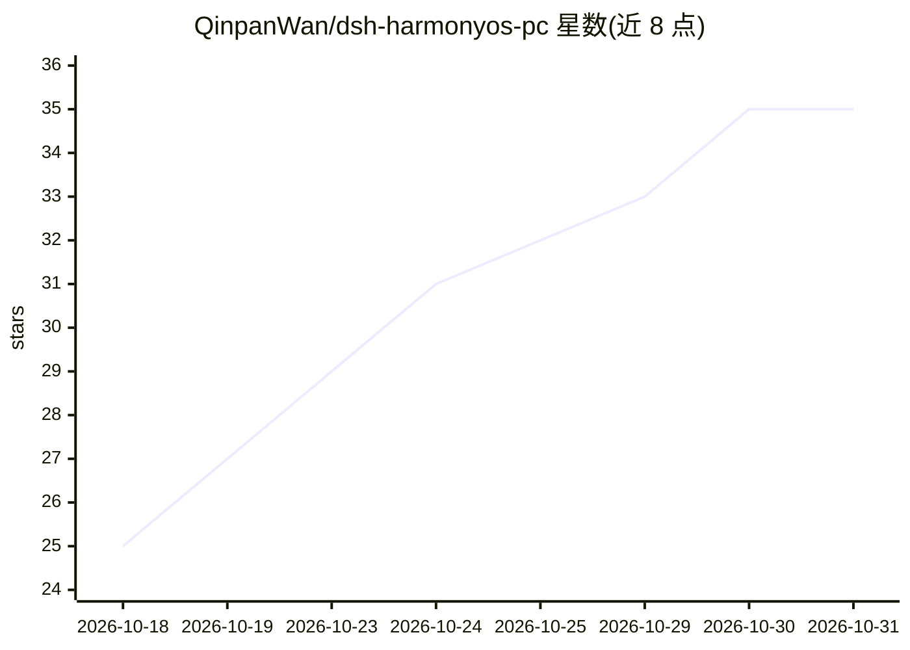

# QinpanWan/dsh-harmonyos-pc

⭐ 35 · TypeScript · MIT · 推送 2026-10-09 · [GitHub](https://github.com/QinpanWan/dsh-harmonyos-pc) · 个人维护 · 中文 README

**让 DeepSeek Harness(dsh) 在鸿蒙设备上完整运行的适配方案**

面向 HarmonyOS 设备的 DeepSeek Harness（dsh）适配工程：通过启动补丁禁用依赖原生二进制的插件行、node_modules 补丁脚本绕开鸿蒙文件系统限制（chmod 600 被拒、不支持硬链接）、八套针对 DeepSeek 前缀缓存的对话预设（实测缓存命中率 93.8%–98.0%）、GitHub 插件安装器与自更新工具链。另含纯 JS 的防注入插件（本地正则扫描提示注入）与知识库、DevEco 开发等预设。不锁 Node 版本（22/24/26），全仓库为纯文本/纯 JS，可逆卸载。

## 筛选速览

| 维度 | 判定 | 备注 |
|---|---|---|
| AI 角色 | `ai-ecosystem` | LLM/agent 周边工具 |
| 许可风险 | `permissive` | MIT |
| 部署形态 | `library` | 以包/库形式分发 |
| 模型依赖 | locked-api |  |
| 硬件要求 | — | 无带数字的原话,不猜 |
| 安装摩擦 | `medium` | 含编译或系统依赖之一 |
| 成熟度 | — | 结构信号不足 |

## 能力要点

- 启动补丁与 node_modules 补丁绕开鸿蒙无原生 ELF、chmod 600 被拒、不支持硬链接等限制
- 八套鸿蒙对话模式预设，静态前缀缓存命中率实测 93.8%–98.0%
- 纯 JS 零依赖的防注入插件 dsh-prompt-antivirus，本地扫描工具参数/结果/消息
- GitHub 插件一键安装器与 dsh 自更新器（fetch 源码→构建→软链，绕过 isogit 垫片）

## 适用场景

- 在鸿蒙 PC/平板上安装并运行 DeepSeek Harness 而不启动即崩
- 通过缓存优化的对话预设降低 DeepSeek 调用 token 成本
- 把工作区当知识库做检索问答与 Obsidian 双链笔记
- 通过 harmony-deveco 预设走通 ArkTS 编译→装真机→启动的开发闭环

## 场景标签

`AI 助手` `知识库管理` `编码 Agent` · 领域:编码与开发

## 证据(README 行号)

> L13: 让 DeepSeek Harness（dsh）在 **HarmonyOS / 鸿蒙** 设备上完整跑起来的全套适配方案。
> L30: > - **启动补丁** `harmony.patch.yml`（web）+ `harmony-headless.patch.yml`（headless）：禁用依赖原生二进制的插件行，让 dsh 不再启动即崩
> L53: |无法加载原生 ELF / `.node` 模块|`node-pty`(subprocess)、`Koffi`(sandbox/fs-local) 启动即崩|`harmony.patch.yml` 禁用这些插件行|

## 星数曲线

2026-10-18 25 → 2026-10-31 35（+10）

---
*卡片 v1 · prompt 1.4 · 生成 2026-10-26 · 置信度 high · 依据 README sha `9d54bbd808ff` · [字段定义](../../DATASET.md)*
