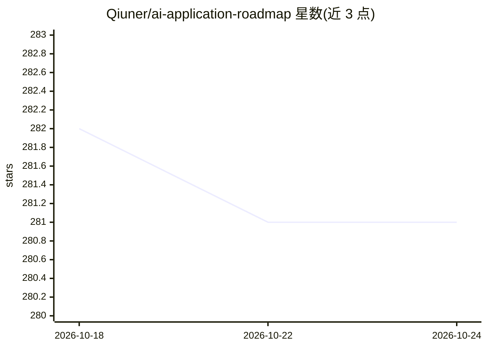

# Qiuner/ai-application-roadmap

⭐ 281 · NOASSERTION · 推送 2026-06-08 · [GitHub](https://github.com/Qiuner/ai-application-roadmap) · 个人维护 · 中文 README

**双语 AI 应用工程演进路线图网站（时间线+指南）**

一个基于 VitePress 的双语（中/英）知识站点，以时间线形式记录 MCP、Function Calling、Skills、Harness、Multi-Agent 等应用工程技术的演进，以及真实工作中的 AI 使用方式与 vibe coding 工作流变化。每个时间线节点含日期、生命周期阶段、趋势、认知校准与采用成本等 frontmatter 字段，支持按年份、阶段、标签筛选。面向想判断当前所处位置与下一步学习方向的工程师，通过 GitHub Pages 浏览，通过提交 PR 添加 docs/en|zh/timeline/ 下的 Markdown 节点参与共建。

## 筛选速览

| 维度 | 判定 | 备注 |
|---|---|---|
| AI 角色 | `ai-knowledge` | 知识聚合/清单类 |
| 许可风险 | `none` | NOASSERTION |
| 部署形态 | `library` | 以包/库形式分发 |
| 模型依赖 | — | README 未给出锁定关系 |
| 硬件要求 | — | 无带数字的原话,不猜 |
| 安装摩擦 | `low` | 无编译、无系统依赖或容器化 |
| 成熟度 | — | 结构信号不足 |

## 能力要点

- 按时间线记录 MCP/Function Calling/Skills/Harness/Multi-Agent 等技术的应用工程演进
- 每个节点带 phase/trend/signal/adoption_effort 等结构化 frontmatter 字段
- 双语内容（/en/ 与 /zh/ 路由），支持年份、阶段、标签等筛选
- 通过 PR 添加时间线节点文件的众包共建机制

## 适用场景

- 系统了解 AI 应用工程技术的演进脉络与关键节点
- 判断某项技术当前的生命周期阶段与采用成本
- 中英双语学习 MCP、Multi-Agent、Context Engineering 等主题

## 场景标签

`教程课程` · 领域:学习与行业

## 证据(README 行号)

> L24: `ai-application-roadmap` 是一张双语的 AI 应用工程地图。它记录的不只是 MCP、Function Calling、Skills、Harness、Multi-agent 等技术的演进，也记录 AI 在真实
> L32: This year, I posted a video about coding styles popular in 2026, from traditional coding to multi-agent collaborati

## 星数曲线

2026-10-18 282 → 2026-10-24 281（-1）

---
*卡片 v1 · prompt 1.4 · 生成 2026-10-22 · 置信度 high · 依据 README sha `107ce523a14e` · [字段定义](../../DATASET.md)*
