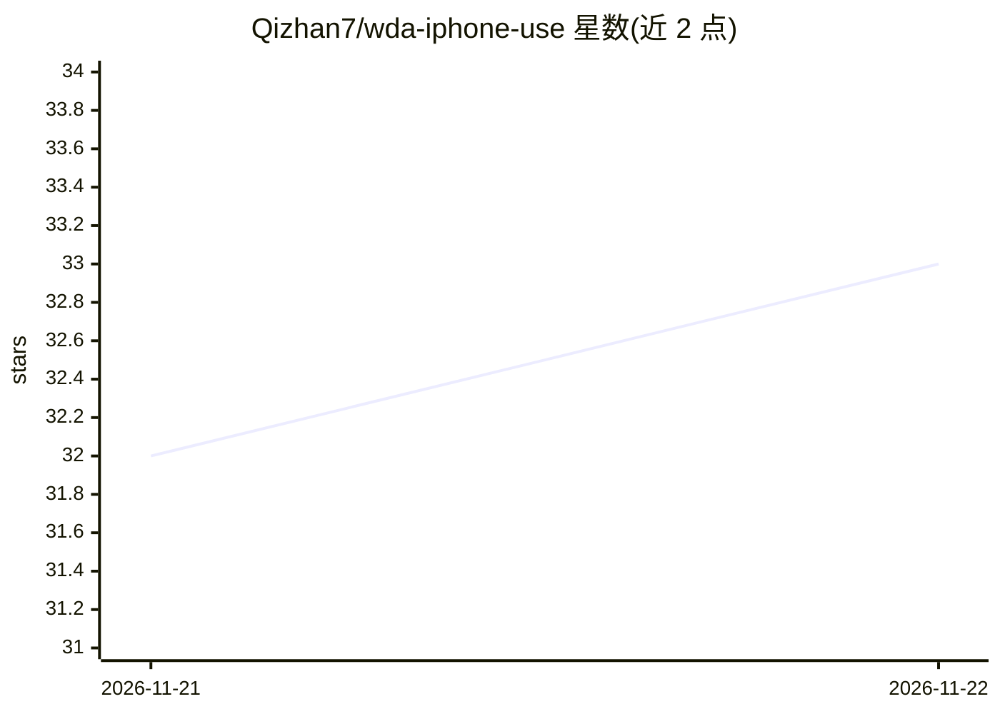

# Qizhan7/wda-iphone-use

⭐ 33 · Python · 推送 2026-11-20 · [GitHub](https://github.com/Qizhan7/wda-iphone-use) · 个人维护 · 中文 README

**让 AI 通过 MCP 控制真实 iPhone 的服务器**

基于 WebDriverAgent 的 MCP 服务器，提供 22 个工具，按 setup/learn/core/wechat/util 分组加载以控制 token 开销；AI 可读取屏幕文本、截图、点击、滑动、输入、打开应用与 URL，并内置微信消息读写一体化调用。支持 Claude Code、claude.ai、Codex、ChatGPT 等 MCP 客户端，本地 stdio 或带 OAuth/Bearer 的 HTTP 远程模式。需 Mac+Xcode 或仅 Windows PC 部署 WDA（免费 Apple 开发者账号签名），经 WiFi 或 Tailscale 远程访问，无需越狱。

## 筛选速览

| 维度 | 判定 | 备注 |
|---|---|---|
| AI 角色 | `ai-ecosystem` | LLM/agent 周边工具 |
| 许可风险 | `none` | — |
| 部署形态 | `desktop` | 安装包/桌面程序 |
| 模型依赖 | — | README 未给出锁定关系 |
| 硬件要求 | — | 无带数字的原话,不猜 |
| 安装摩擦 | `medium` | 含编译或系统依赖之一 |
| 成熟度 | — | 结构信号不足 |

## 能力要点

- 22 个工具按场景分组，可通过 WDA_TOOLS 环境变量选择性加载
- App 布局学习：扫描一次 UI 坐标并缓存复用
- 微信消息读写单次 MCP 往返完成，附端到端耗时数据
- 支持 Tailscale 远程访问，Windows PC 无 Mac 部署路径

## 适用场景

- 让 Claude 或 ChatGPT 代替我操作真机 iPhone 应用
- 远程通过 Tailscale 让 AI 读取和回复微信消息
- 自动化测试或演示中的 iPhone 屏幕交互流程

## 场景标签

`GUI 自动化` · 领域:效率与自动化

## 证据(README 行号)

> L3: # wda-iphone-use — Let AI Use a Real iPhone
> L11: - **Let the AI drive it.** Tap, swipe, type, take screenshots and read what is on the screen, through an MCP server
> L138: - **Python 3.12+** with `mcp[cli]` installed

## 星数曲线

2026-11-21 32 → 2026-11-22 33（+1）

---
*卡片 v1 · prompt 1.4 · 生成 2026-11-21 · 置信度 high · 依据 README sha `e281e84934a7` · [字段定义](../../DATASET.md)*
