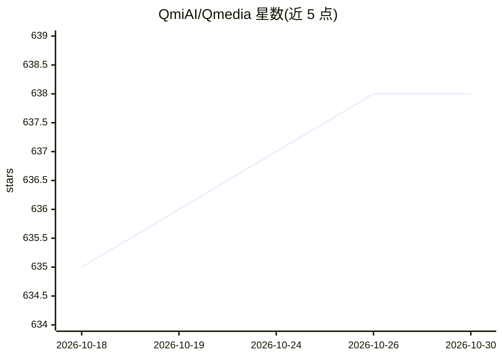

# QmiAI/Qmedia

⭐ 638 · TypeScript · MIT · 推送 2026-04-09 · [GitHub](https://github.com/QmiAI/Qmedia) · 组织维护 · 中文 README

**面向内容创作者的多模态 AI 内容搜索引擎，支持全本地部署**

开源多媒体 AI 内容搜索引擎，面向内容创作者，覆盖图文与短视频素材的搜索、信息抽取与多模态 RAG 问答。由三个可分离部署的服务组成：Next.js 实现的 Web 服务、基于 LlamaIndex 的 RAG 检索问答服务、以及多模态模型服务（Ollama 部署 LLM、CLIP/BGE 嵌入、OCR、Faster Whisper 视频转录）。支持全本地离线部署处理私有数据，模型服务也可独立经 API 调用。替换素材后需删除历史 db 文件重建索引。

## 筛选速览

| 维度 | 判定 | 备注 |
|---|---|---|
| AI 角色 | `ai-native` | 本体是模型或模型工具 |
| 许可风险 | `permissive` | MIT |
| 部署形态 | `None` |  |
| 模型依赖 | local-ok | 支持本地模型 |
| 硬件要求 | — | 无带数字的原话,不猜 |
| 安装摩擦 | `low` | 无编译、无系统依赖或容器化 |
| 成熟度 | — | 结构信号不足 |

## 能力要点

- 图文/短视频多模态内容抽取与 RAG 问答，结果以内容卡片呈现并附来源
- Web/RAG/模型三个服务可分离部署，模型层可替换并支持本地模型生命周期管理
- 支持 Ollama 本地 LLM 切换、CLIP/BGE 嵌入、Qanything OCR、Faster Whisper 视频转录
- 模型服务可独立作为图像编码/文本编码/视频转录/OCR 的 API 服务

## 适用场景

- 内容创作者搜索和整理图文、短视频素材
- 私有数据本地离线的内容检索与问答
- 作为独立的多模态信息抽取 API 服务接入其他系统

## 场景标签

`RAG` `多模态` `语义搜索` · 领域:知识与检索

## 证据(README 行号)

> L29: **QMedia** is an open-source multimedia AI content search engine , provides rich information extraction methods for
> L58:  - Extract useful information from image/text and short video content based on user queries to generate high-qualit
> L21: - Local deployment, enabling offline content search and Q&A for private data.

## 星数曲线

2026-10-18 635 → 2026-10-30 638（+3）

---
*卡片 v1 · prompt 1.4 · 生成 2026-10-21 · 置信度 high · 依据 README sha `9c3a51f23f3e` · [字段定义](../../DATASET.md)*
