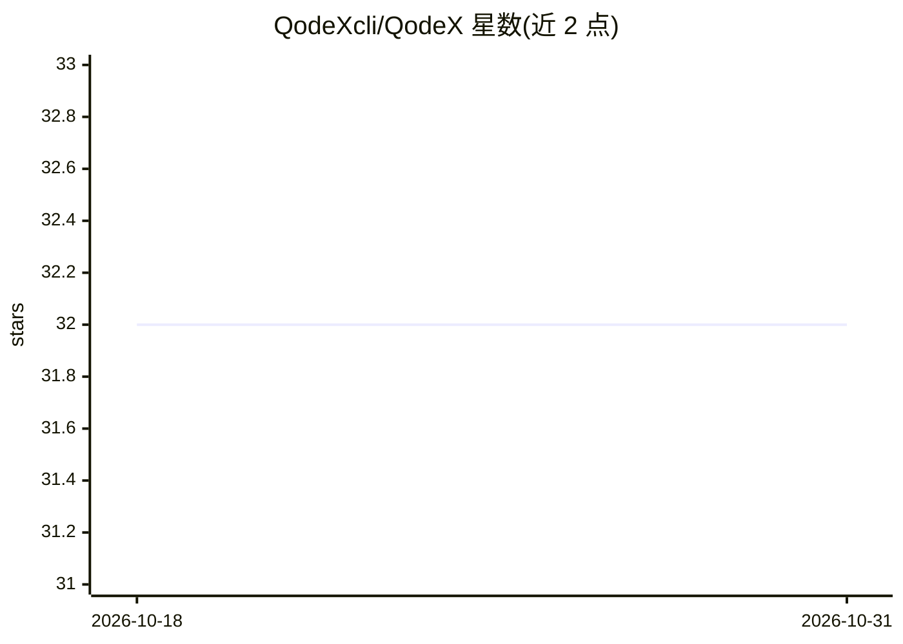

# QodeXcli/QodeX

⭐ 32 · TypeScript · Apache-2.0 · 推送 2026-10-03 · [GitHub](https://github.com/QodeXcli/QodeX) · [官网](https://qodexcli.github.io/QodeX/) · 组织维护

**本地优先的终端 AI 编码 agent，默认跑本地模型**

运行在终端里的 agentic 编码 CLI：默认通过 Ollama / LM Studio 运行 Qwen3-Coder 等本地模型，Claude / GPT / Gemini / DeepSeek 为可选云端回退。提供 100+ 内置工具（文件编辑、Tree-sitter 代码图、Playwright 浏览器、dev server、网页搜索、vision），并在 agent 循环外围运行确定性护栏：语法门、完成门、按语言自动验证、Git 沙箱、Docker 进程沙箱。另含自我改进技能循环、跨会话本地记忆、Telegram/Discord/Slack 网关、cron 定时任务与可分享的实时 artifact。Apache-2.0，安装方式为 curl 安装脚本。

## 筛选速览

| 维度 | 判定 | 备注 |
|---|---|---|
| AI 角色 | `ai-native` | 本体是模型或模型工具 |
| 许可风险 | `permissive` | Apache-2.0 |
| 部署形态 | `self-host` | docker 或自建部署 |
| 模型依赖 | local-ok | 支持本地模型 |
| 硬件要求 | — | 无带数字的原话,不猜 |
| 安装摩擦 | `low` | 无编译、无系统依赖或容器化 |
| 成熟度 | — | 结构信号不足 |

## 能力要点

- 默认经 Ollama / LM Studio 运行本地模型，云端模型为 opt-in 回退
- 语法门/完成门/自动验证等确定性护栏运行在 agent 循环外围
- 100+ 工具：AST 编辑、Tree-sitter 代码图、Playwright 浏览器、Docker/DB/MCP
- 自我改进技能循环（独立评审模型 + UCB1 A/B + 情景记忆）

## 适用场景

- 在终端里用自然语言驱动代码阅读、编辑、测试与 PR 生成
- 本地跑 Qwen 模型做编码助手，代码不出本机
- 无人值守定时任务（Autonomous Verified PR）与手机端遥控 agent

## 场景标签

`编码 Agent` · 领域:编码与开发

## 证据(README 行号)

> L3: Most agent CLIs are a rented brain with a terminal skin. QodeX is the opposite: a **local-first agentic coding CLI**
> L25: - **Local-first & private** — runs entirely on *your* models (Qwen-Coder via Ollama / LM Studio); your code never l

## 星数曲线

2026-10-18 32 → 2026-10-31 32（+0）

---
*卡片 v1 · prompt 1.4 · 生成 2026-10-26 · 置信度 mid · 依据 README sha `1f11d530403e` · [字段定义](../../DATASET.md)*
