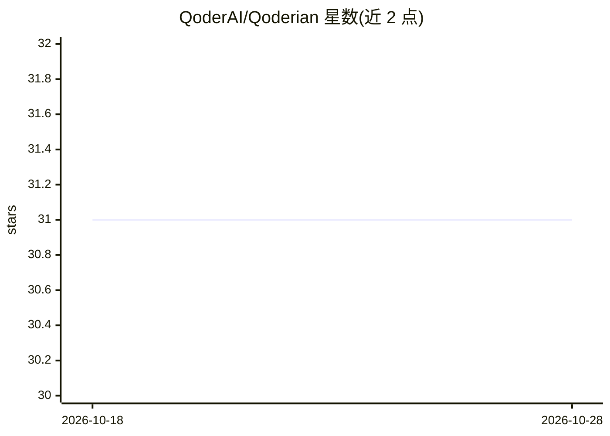

# QoderAI/Qoderian

⭐ 31 · TypeScript · MIT · 推送 2026-10-12 · [GitHub](https://github.com/QoderAI/Qoderian) · [官网](https://qoderai.github.io/Qoderian/docs/introduction) · 组织维护 · 中文 README

**在 Obsidian 内嵌入 Qoder CLI 作为 AI 协作者的插件**

Obsidian 桌面插件，将 Qoder CLI（qodercli）作为 agent 嵌入笔记库，库目录即 agent 工作目录：支持文件读写/编辑/搜索、bash 命令（实验性、需开启）、斜杠命令与技能、子 agent、MCP 服务器接入与多标签会话。登录与凭据完全由本地 qodercli 管理，插件不索取 API key；输入与附件经 qodercli 发送到 Qoder 服务。仅支持桌面端（Obsidian v1.7.2+），Qoder 是唯一集成对象，无 provider 注册机制。该项目从 MIT 许可的 Claudian 衍生。

## 筛选速览

| 维度 | 判定 | 备注 |
|---|---|---|
| AI 角色 | `ai-enhanced` | 去掉 AI 部分产品仍成立 |
| 许可风险 | `permissive` | MIT |
| 部署形态 | `desktop` | 安装包/桌面程序 |
| 模型依赖 | — | README 未给出锁定关系 |
| 硬件要求 | — | 无带数字的原话,不猜 |
| 安装摩擦 | `low` | 无编译、无系统依赖或容器化 |
| 成熟度 | — | 结构信号不足 |

## 能力要点

- vault 即 agent 工作目录：读/写/编辑/搜索文件与多步工作流
- 通过 MCP（stdio/SSE/HTTP）接入外部工具
- Inline Edit 提供 diff 预览后就地改写选中文字
- 登录由本地 qodercli 管理，插件不经手 API key

## 适用场景

- 在 Obsidian 笔记库内直接与 AI agent 协作整理、改写笔记
- 通过对话让 agent 在库内执行多步文件操作
- 把外部工具经 MCP 挂入笔记工作流

## 场景标签

`知识库管理` · 领域:知识与检索

## 证据(README 行号)

> L9: An Obsidian plugin that embeds Qoder CLI (`qodercli`) in your vault. Your vault becomes the agent's working director
> L15: - **Agentic chat** — qodercli streams responses into the sidebar and reads, writes, edits, and searches files in yo
> L204: Qoderian drives qodercli through `@qoder-ai/qoder-agent-sdk@^1.0.41`; `custom-spawn.ts` only handles Obsidian/Elec

## 星数曲线

2026-10-18 31 → 2026-10-28 31（+0）

---
*卡片 v1 · prompt 1.4 · 生成 2026-10-26 · 置信度 mid · 依据 README sha `fc8ba4522113` · [字段定义](../../DATASET.md)*
