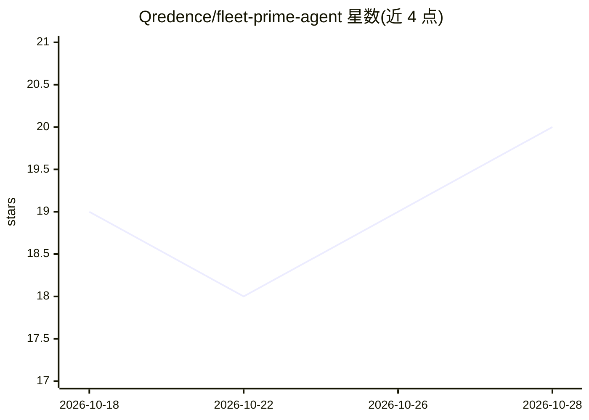

# Qredence/fleet-prime-agent

⭐ 20 · TypeScript · MIT · 推送 2026-10-27 · [GitHub](https://github.com/Qredence/fleet-prime-agent) · [官网](https://qredence.ai) · 组织维护

**Prime Agent 编码智能体的本地浏览器工作界面**

Fleet 是面向编码与研究的本地工作区：在浏览器中打开项目，与 agent 对话并观察其读取文件、执行命令、产出结果的过程。Fleet 提供界面并运行固定版本的 Rust 版 Prime Agent 0.10+ 运行时（首次启动自动下载、校验并缓存）。支持持久会话、工作区文件浏览、托管 IPython 环境、provider/模型配置与规划流程。要求 macOS/Linux（x64/ARM64）、Node.js 22.12+，不支持 Windows；以 npm 全局安装运行。

## 筛选速览

| 维度 | 判定 | 备注 |
|---|---|---|
| AI 角色 | `ai-ecosystem` | LLM/agent 周边工具 |
| 许可风险 | `permissive` | MIT |
| 部署形态 | `library` | 以包/库形式分发 |
| 模型依赖 | — | README 未给出锁定关系 |
| 硬件要求 | — | 无带数字的原话,不猜 |
| 安装摩擦 | `low` | 无编译、无系统依赖或容器化 |
| 成熟度 | — | 结构信号不足 |

## 能力要点

- 浏览器中查看 agent 的响应、命令执行、文件编辑与子 agent 活动
- 自动下载并固定校验 Rust 版 Prime Agent 运行时
- 托管 IPython 环境用于交互式分析与文件操作
- 兼容早期 TypeScript 运行时的设置与会话数据

## 适用场景

- 在浏览器里与编码 agent 协作完成项目任务
- 跨项目管理 agent 会话并持久恢复
- 交互式运行分析代码并检查生成的产物

## 场景标签

`编码 Agent` · 领域:编码与开发

## 证据(README 行号)

> L3: Fleet Prime is a local workspace for coding and research with AI. Open a project
> L6: **Rust-based Prime Agent

## 星数曲线

2026-10-18 19 → 2026-10-28 20（+1）

---
*卡片 v1 · prompt 1.4 · 生成 2026-10-28 · 置信度 high · 依据 README sha `5963325b9a4b` · [字段定义](../../DATASET.md)*
