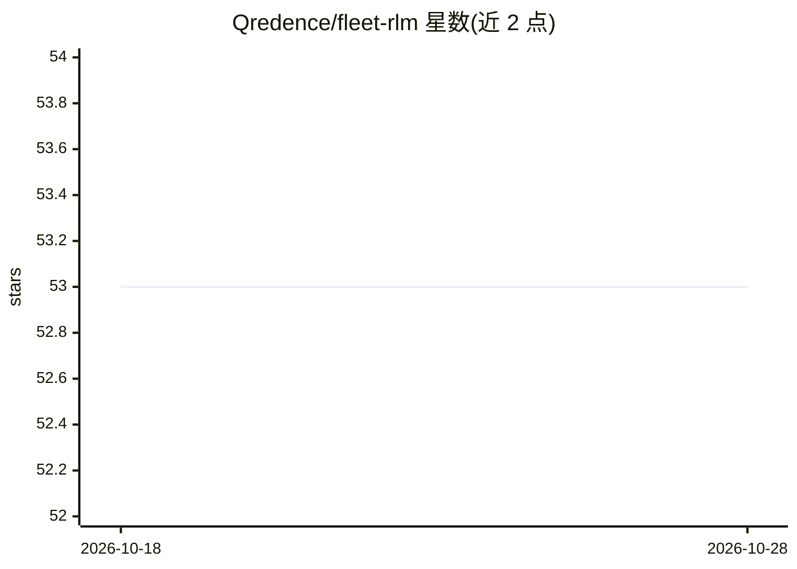

# Qredence/fleet-rlm

⭐ 53 · Python · MIT · 推送 2026-10-26 · [GitHub](https://github.com/Qredence/fleet-rlm) · [官网](https://docs.qredence.ai/) · 组织维护

**Python agent 运行时：文件分析、代码执行与任务委派**

Fleet-RLM（又称 Fleet RLM Lite）是用 Python 编写的 agent 运行时，结合 DSPy 推理、Daytona 沙箱执行、PostgreSQL 持久化与 MLflow 追踪，通过 Textual 终端客户端流式展示 agent 活动，用于探索数据、执行计算并产出可下载工件。提供 hybrid/rlm/flex 三种会话模式，支持向隔离子沙箱委派任务并带回工件。需 Python 3.11–3.13、uv、可达的 PostgreSQL、Daytona 组织与 Volume、Databricks Unity Gateway 模型授权；模型调用与沙箱执行可能产生费用。API 默认仅监听回环地址且无调用方认证。

## 筛选速览

| 维度 | 判定 | 备注 |
|---|---|---|
| AI 角色 | `ai-native` | 本体是模型或模型工具 |
| 许可风险 | `permissive` | MIT |
| 部署形态 | `None` |  |
| 模型依赖 | — | README 未给出锁定关系 |
| 硬件要求 | — | 无带数字的原话,不猜 |
| 安装摩擦 | `medium` | 含编译或系统依赖之一 |
| 成熟度 | — | 结构信号不足 |

## 能力要点

- hybrid/rlm/flex 三种会话模式与路由回退机制
- 大输入留在工作区文件，模型接收路径、元数据与受限预览
- 向隔离子沙箱委派任务、共享 Turn 预算并按来源提升子工件
- GEPA 优化 DSPy 指令与 Flex 源码，MLflow 提供追踪诊断

## 适用场景

- 在终端会话中让 agent 分析 CSV 数据并生成工件
- 以迭代代码-观察循环执行计算与数据探索任务
- 在隔离沙箱中委派子任务并复用其产出工件

## 场景标签

`Agent 框架` `数据分析` · 领域:Agent 开发

## 证据(README 行号)

> L3: **A Python agent runtime for analyzing files, executing code, and delegating tasks.**
> L6: and MLflow tracing. Its Textual terminal client streams activity while agents
> L7: explore data, run calculations, and produce downloadable artifacts. The current

## 星数曲线

2026-10-18 53 → 2026-10-28 53（+0）

---
*卡片 v1 · prompt 1.4 · 生成 2026-10-24 · 置信度 high · 依据 README sha `3e2eda1e4cee` · [字段定义](../../DATASET.md)*
