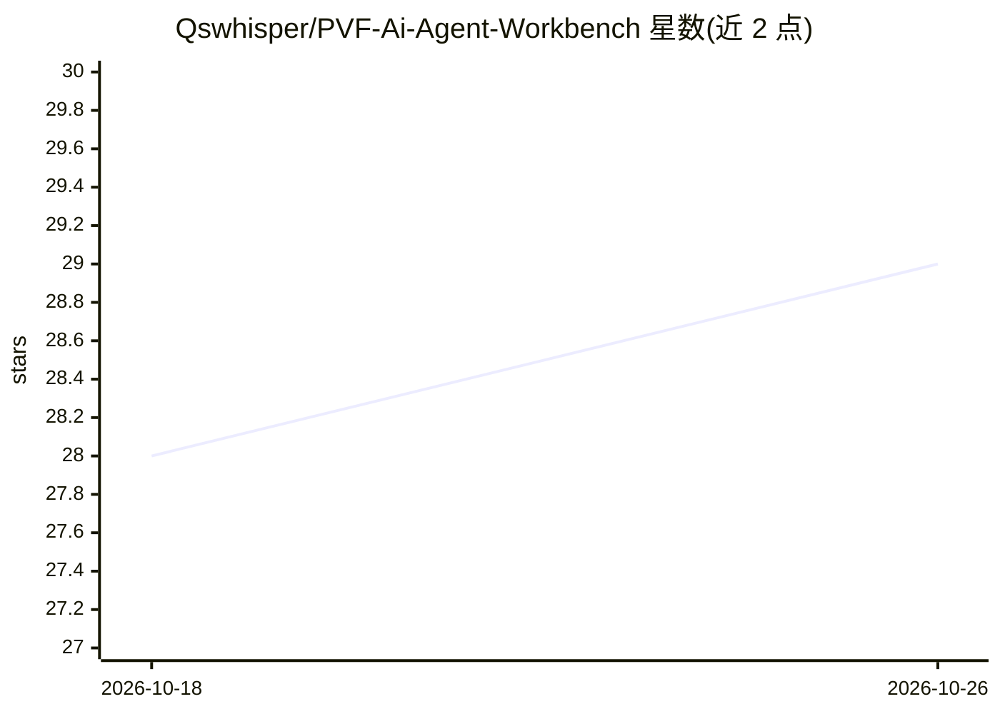

# Qswhisper/PVF-Ai-Agent-Workbench

⭐ 29 · JavaScript · MIT · 推送 2026-09-28 · [GitHub](https://github.com/Qswhisper/PVF-Ai-Agent-Workbench) · [官网](https://tieba.baidu.com/p/10812134872) · 个人维护 · 中文 README

**让桌面 AI Agent 安全查看与修改 DNF Script.pvf 的便携工作台**

面向不熟悉代码用户的 Windows 便携工作台：为 Codex、Claude Code、OpenCode 等命令型 Agent 提供运行环境、PVF 工具、知识路由与安全规则，用于查询 DNF Script.pvf 的文件、字段、ID 与登记关系，分析装备、技能、任务、副本等跨文件依赖。修改走“只读分析→预演→用户批准→生成独立修改版 PVF→重新检查”的受控流程；默认只读、不覆盖源 PVF。随包携带 Node.js 与预编译 native 后端；后端不可用时自动进入只读模式（可查询但不能生成 PVF）。

## 筛选速览

| 维度 | 判定 | 备注 |
|---|---|---|
| AI 角色 | `ai-ecosystem` | LLM/agent 周边工具 |
| 许可风险 | `permissive` | MIT |
| 部署形态 | `None` |  |
| 模型依赖 | — | README 未给出锁定关系 |
| 硬件要求 | — | 无带数字的原话,不猜 |
| 安装摩擦 | `low` | 无编译、无系统依赖或容器化 |
| 成熟度 | — | 结构信号不足 |

## 能力要点

- 查询 PVF 文件、字段、名称、ID 与登记关系及跨文件依赖
- 受控修改流程：只读分析→预演→批准→生成独立修改版→复查
- 默认只读，生成阶段不覆盖源 PVF，部署可回滚
- 自包含运行环境（随包 Node.js），无需 npm、外部 MCP

## 适用场景

- 让 AI Agent 帮我查看和分析 DNF 的 Script.pvf 内容
- 在受控流程下生成修改版 PVF 并在测试客户端部署验证
- 做跨版本 PVF 比较与客户端兼容性检查

## 场景标签

`编码 Agent` · 领域:编码与开发

## 证据(README 行号)

> L3: 这是一个让桌面 AI Agent 帮你查看和修改 DNF `Script.pvf` 的便携工作台。它自带运行环境、PVF 工具、知识路由和安全规则，适合不熟悉代码的用户。
> L9: 3. 用 Codex、Claude Code、OpenCode 或其他命令型 Agent 打开整个工作台文件夹。
> L33: 支持 64 位 Windows，随包携带 Node.js，不需要 npm、外部 MCP 或已下架插件。native 后端不可用时会自动进入只读模式；查询仍可用，但不能生成 PVF。

## 星数曲线

2026-10-18 28 → 2026-10-26 29（+1）

---
*卡片 v1 · prompt 1.4 · 生成 2026-10-26 · 置信度 high · 依据 README sha `ac3c037ecb7c` · [字段定义](../../DATASET.md)*
