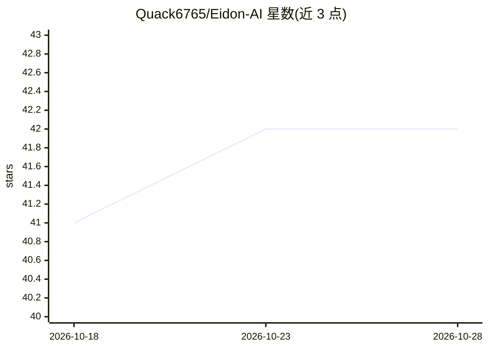

# Quack6765/Eidon-AI

⭐ 43 · TypeScript · AGPL-3.0 · 推送 2026-10-12 · [GitHub](https://github.com/Quack6765/Eidon-AI) · [官网](https://eidonai.app) · 个人维护 · 中文 README

**自托管 BYOK 多 agent 协作与日常对话 AI 平台**

以单个 Docker 镜像部署的自托管 AI 平台，包含两部分：多 agent 团队（Chief of Staff 分派任务、agent 间消息协作、各自独立浏览器/记忆/文件、沙箱 shell）与日常聊天（记忆、rewind/fork、文件夹、语音输入）。内置 Web 搜索、深度研究、MCP、技能、图像生成、定时自动化等。数据存于单个 SQLite 文件，凭据加密，支持多用户。接入 OpenAI、Anthropic、OpenRouter、Ollama 等自带 key 的模型提供商，AGPL-3.0 开源。内置浏览器要求 --shm-size=1g。

## 筛选速览

| 维度 | 判定 | 备注 |
|---|---|---|
| AI 角色 | `ai-native` | 本体是模型或模型工具 |
| 许可风险 | `viral` | AGPL-3.0 |
| 部署形态 | `self-host` | docker 或自建部署 |
| 模型依赖 | local-ok | 支持本地模型 |
| 硬件要求 | — | 无带数字的原话,不猜 |
| 安装摩擦 | `low` | 无编译、无系统依赖或容器化 |
| 成熟度 | — | 结构信号不足 |

## 能力要点

- 多 agent 团队：Chief of Staff 分派、agent 互发消息、各自独立浏览器与沙箱
- 单 Docker 镜像部署，数据存单个 SQLite 文件，凭据加密，多用户私有数据
- 内置 Web 搜索、深度研究（可编辑计划）、MCP、技能、图像生成、定时自动化
- 支持 OpenAI/Anthropic/OpenRouter/Ollama 等 20 个提供商及 OpenAI/Anthropic 兼容接口

## 适用场景

- 自建带浏览器的 agent 团队替我查机票、整理收件箱、比价供应商
- 自托管日常 AI 聊天，数据留在自己服务器
- 通过自带模型 key 按需切换 OpenAI/Ollama 等提供商

## 场景标签

`多智能体` `聊天机器人` `图像生成` · 领域:Agent 开发

## 证据(README 行号)

> L36: Eidon is a self-hosted AI platform. It is a **team of agents** that do work on their own, in
> L37: their own browsers, and an **everyday chat** for the questions that do not need a team. It runs
> L72: - Works with OpenAI, Anthropic, OpenRouter, Ollama, and many more

## 星数曲线

2026-10-18 41 → 2026-10-28 42（+1）

---
*卡片 v1 · prompt 1.4 · 生成 2026-10-25 · 置信度 high · 依据 README sha `90beaf95bcc1` · [字段定义](../../DATASET.md)*
