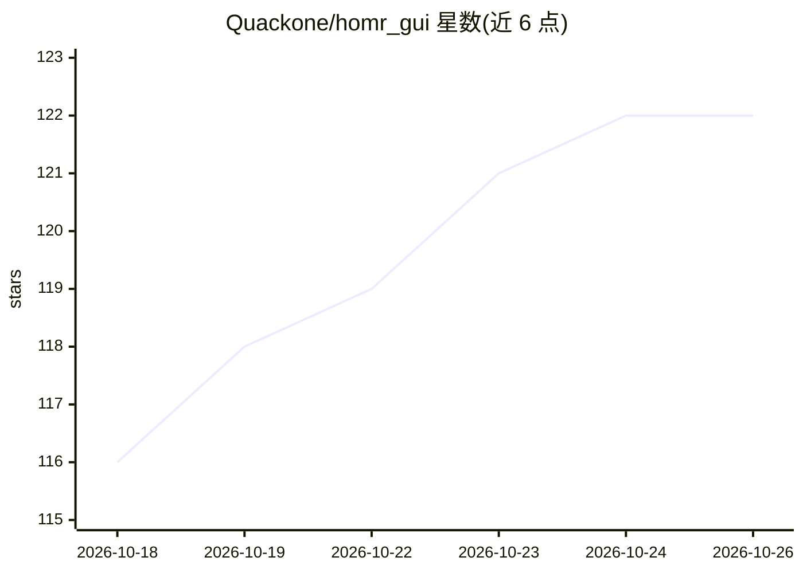

# Quackone/homr_gui

⭐ 122 · Jupyter Notebook · AGPL-3.0 · 推送 2026-09-05 · [GitHub](https://github.com/Quackone/homr_gui) · 个人维护 · 中文 README

**光学乐谱识别桌面 GUI：截图/拖图一键转 MusicXML 与 MIDI**

基于 PyQt6 的桌面应用，封装 liebharc/homr 端到端光学乐谱识别（OMR）系统（视觉 Transformer）。用户用 Win+Shift+S 框选或拖入乐谱图片，AI 引擎自动识别并导出 .musicxml 与 .mid 文件，可直接拖入 DAW。提供 CPU（onnxruntime）与 GPU（onnxruntime-gpu + CUDA）两种运行模式，Windows 自带 bat 启动脚本。需 Python 3.11–3.15，从源码克隆安装；模型下载经镜像代理加速，双语 README。

## 筛选速览

| 维度 | 判定 | 备注 |
|---|---|---|
| AI 角色 | `ai-native` | 本体是模型或模型工具 |
| 许可风险 | `viral` | AGPL-3.0 |
| 部署形态 | `library` | 以包/库形式分发 |
| 模型依赖 | — | README 未给出锁定关系 |
| 硬件要求 | — | 无带数字的原话,不猜 |
| 安装摩擦 | `medium` | 含编译或系统依赖之一 |
| 成熟度 | — | 结构信号不足 |

## 能力要点

- 截图/拖拽乐谱图片一键识别导出 MusicXML 与 MIDI
- 基于视觉 Transformer 的 HOMR 端到端 OMR 引擎
- CPU / GPU 模式切换（onnxruntime / onnxruntime-gpu + CUDA）
- 模型下载走国内镜像代理

## 适用场景

- 把纸质或截图乐谱转成 MIDI 拖入 DAW 编辑
- 不熟悉命令行的音乐人做光学乐谱识别
- 将乐谱数字化为 MusicXML 供打谱软件使用

## 场景标签

 · 领域:音乐信息检索/桌面工具

## 证据(README 行号)

> L16: **HOMR GUI** is a desktop graphical front-end for liebharc/homr, an end-to-end Optical Music Recognition (OMR) syst
> L81: 2. The AI engine recognizes the score automatically.

## 星数曲线

2026-10-18 116 → 2026-10-26 122（+6）

---
*卡片 v1 · prompt 1.4 · 生成 2026-10-23 · 置信度 mid · 依据 README sha `20f4343e7718` · [字段定义](../../DATASET.md)*
