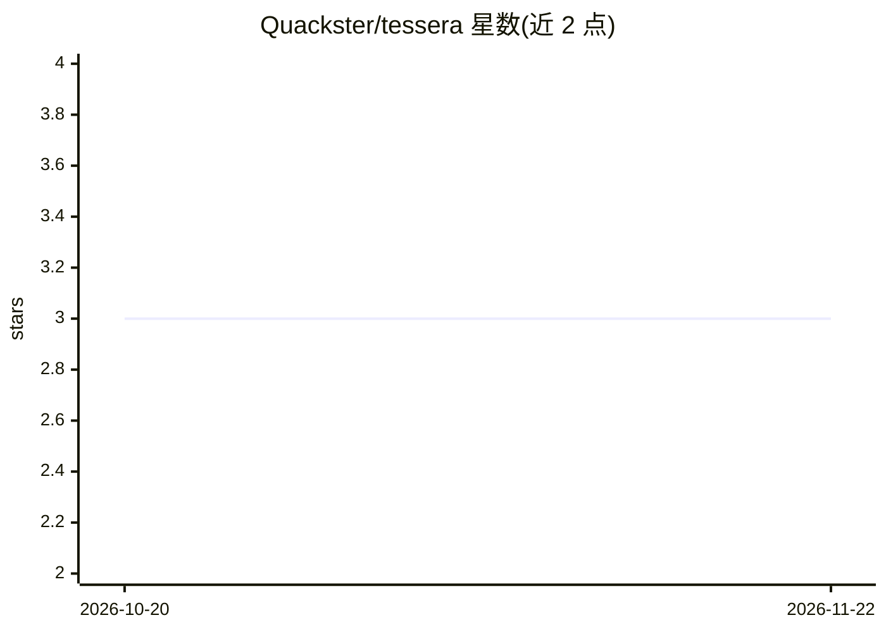

# Quackster/tessera

⭐ — · [GitHub]() · 个人维护

**面向 AMD GPU 的 LLM 推理引擎，支持 ROCm 与 Vulkan 双后端**

C++20 编写的 LLM 推理引擎，在 GPU 上运行开放权重模型，提供 Vulkan（跨厂商）与 ROCm（AMD GPU）两个编译期二选一的后端。支持 GGUF/MXFP4 权重加载、MTP 与 DFlash2 投机解码、多 GPU 并行布局（tp/pipeline/cp/hybrid）、多种量化 KV cache、HTTP serve 与内置聊天 UI、校准基准工具。作者声明项目处于重度开发状态，API 可能变动，尚未达到生产可用。

## 筛选速览

| 维度 | 判定 | 备注 |
|---|---|---|
| AI 角色 | `ai-ecosystem` | LLM/agent 周边工具 |
| 许可风险 | `permissive` | — |
| 部署形态 | `self-host` | docker 或自建部署 |
| 模型依赖 | — | README 未给出锁定关系 |
| 硬件要求 | — | 无带数字的原话,不猜 |
| 安装摩擦 | `low` | 无编译、无系统依赖或容器化 |
| 成熟度 | `idea` | |

## 能力要点

- GGUF/MXFP4 权重加载与 MTP、DFlash2 两种投机解码策略
- 多 GPU 并行布局：tensor、pipeline、context、expert、speculative split 与 hybrid 模式
- HTTP/1.1 server，支持流式推理、工具调用与内置聊天 UI
- calibrate 命令测量并存储每台机器的最快运行参数

## 适用场景

- 在 AMD GPU 上本地运行 GGUF 格式的大模型推理
- 通过 OpenAI 兼容的 serve 接口向应用提供模型服务
- 在无 Resizable BAR 的多卡环境下按层切分运行大模型

## 场景标签

`推理引擎` · 领域:训练与推理

## 证据(README 行号)

> L7: Tessera is a C++20 LLM inference engine. It runs open weight models on GPU. It has two compute backends. Vulkan supp
> L5: > Status: Heavy development. The API changes without notice. Greedy text generation is stable on the 27B targets. DF

## 星数曲线

2026-10-20 3 → 2026-11-22 3（+0）

---
*卡片 v1 · prompt 1.4 · 生成 2026-11-22 · 置信度 high · 依据 README sha `9b1f5d635ddf` · [字段定义](../../DATASET.md)*
