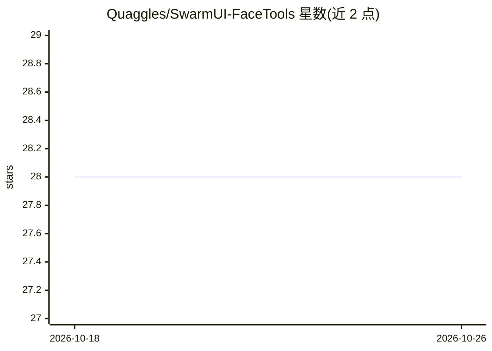

# Quaggles/SwarmUI-FaceTools

⭐ 28 · C# · MIT · 推送 2026-05-09 · [GitHub](https://github.com/Quaggles/SwarmUI-FaceTools) · 个人维护

**SwarmUI 扩展：在生成页加入 ReActor 换脸参数**

为 SwarmUI 提供的扩展，把 ComfyUI ReActor（含不安全内容过滤）节点的参数暴露到 generate 标签页：支持生成后用人脸图片或已保存 Face Model 换脸、换脸后运行一个或两个人脸修复模型（如 codeformer/GPEN）、YOLOv8 分割模型做人脸遮罩、Face Boost 等，参数按选项注入 ComfyUI 工作流节点。提供扩展面板一键安装或 git clone 手动安装，模型需放置在 ComfyUI 后端指定目录。

## 筛选速览

| 维度 | 判定 | 备注 |
|---|---|---|
| AI 角色 | `ai-ecosystem` | LLM/agent 周边工具 |
| 许可风险 | `permissive` | MIT |
| 部署形态 | `None` |  |
| 模型依赖 | — | README 未给出锁定关系 |
| 硬件要求 | — | 无带数字的原话,不猜 |
| 安装摩擦 | `medium` | 含编译或系统依赖之一 |
| 成熟度 | — | 结构信号不足 |

## 能力要点

- 将 ReActor 换脸/修复参数集成到 SwarmUI 生成页
- 支持 Face Image、Face Model、双重人脸修复与 YOLOv8 遮罩
- 含 NSFW 检测，源图不安全时返回黑图
- 提供扩展面板一键安装 ReActor 及依赖

## 适用场景

- 在 SwarmUI 中对生成图像进行换脸与修复
- 通过生成页参数直接控制 ComfyUI ReActor 工作流

## 场景标签

`图像生成` `图像视频处理` · 领域:内容生成

## 证据(README 行号)

> L3: A SwarmUI extension that adds parameters for the ReActor (with unsafe content filter) node to the generate tab.
> L34: These parameters inject different nodes to the workflow based on the options selected.

## 星数曲线

2026-10-18 28 → 2026-10-26 28（+0）

---
*卡片 v1 · prompt 1.4 · 生成 2026-10-26 · 置信度 high · 依据 README sha `f9a9fdbda21a` · [字段定义](../../DATASET.md)*
