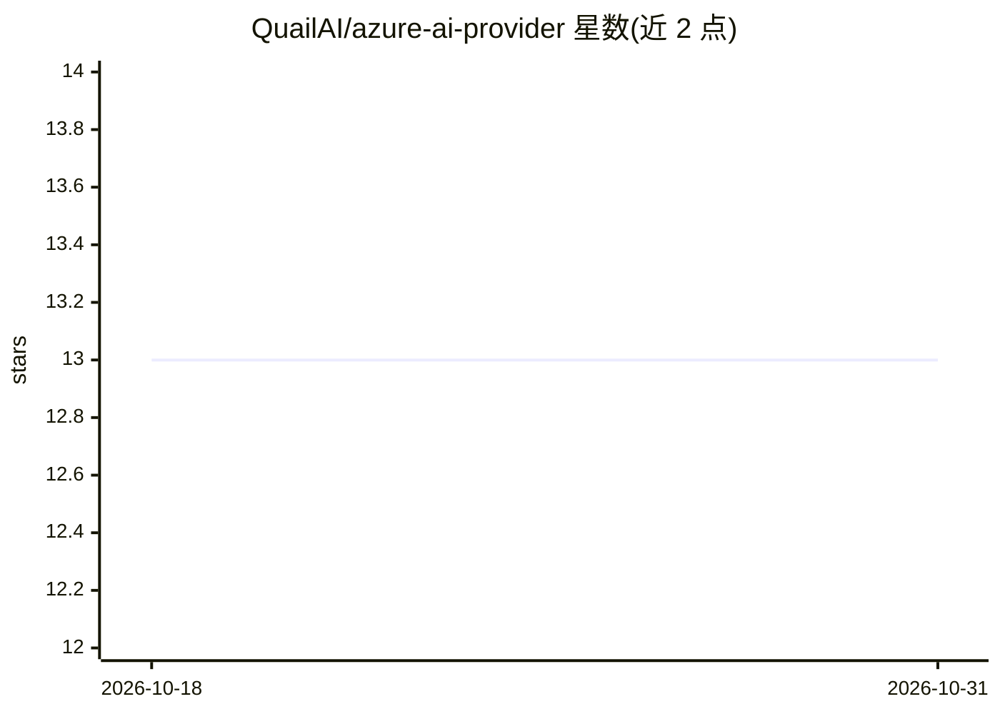

# QuailAI/azure-ai-provider

⭐ 13 · TypeScript · 推送 2026-07-13 · [GitHub](https://github.com/QuailAI/azure-ai-provider) · [官网](https://www.npmjs.com/package/@quail-ai/azure-ai-provider) · 组织维护

**Vercel AI SDK 的 Azure 原生 API 自定义 Provider**

面向使用 Vercel AI SDK 的开发者提供的 Azure 自定义 Provider npm 包：使 AI SDK 可接入使用 Azure 原生 API（而非 OpenAI API 格式）的 Azure 托管语言模型。已支持 Chat Completions（流式与非流式）与图像输入；Tool Calling 已实现但依模型能力而定，Embeddings 已实现但未经测试。通过 createAzure 配置 endpoint、apiKey 与可选 apiVersion，支持流式输出、工具调用、文本嵌入与图像处理示例。

## 筛选速览

| 维度 | 判定 | 备注 |
|---|---|---|
| AI 角色 | `ai-ecosystem` | LLM/agent 周边工具 |
| 许可风险 | `none` | — |
| 部署形态 | `library` | 以包/库形式分发 |
| 模型依赖 | — | README 未给出锁定关系 |
| 硬件要求 | — | 无带数字的原话,不猜 |
| 安装摩擦 | `low` | 无编译、无系统依赖或容器化 |
| 成熟度 | — | 结构信号不足 |

## 能力要点

- 接入 Azure 原生 API 格式的模型而非 OpenAI 格式
- Chat Completions 支持流式与非流式响应
- 支持图像输入、工具调用与文本嵌入（部分为未测试/依赖模型能力）
- 以 npm 包 @quail-ai/azure-ai-provider 提供

## 适用场景

- 在 Vercel AI SDK 应用中调用仅暴露 Azure 原生 API 的模型
- 对 Azure 托管模型使用流式输出与工具调用
- 生成文本嵌入或传入图像输入

## 场景标签

`模型网关` · 领域:Agent 开发

## 证据(README 行号)

> L1: # AI SDK - Azure Custom Provider
> L3: The Azure custom provider for the AI SDK enables integration with Azure-hosted language models that use Azure's nati

## 星数曲线

2026-10-18 13 → 2026-10-31 13（+0）

---
*卡片 v1 · prompt 1.4 · 生成 2026-10-31 · 置信度 high · 依据 README sha `dabf053c2c49` · [字段定义](../../DATASET.md)*
