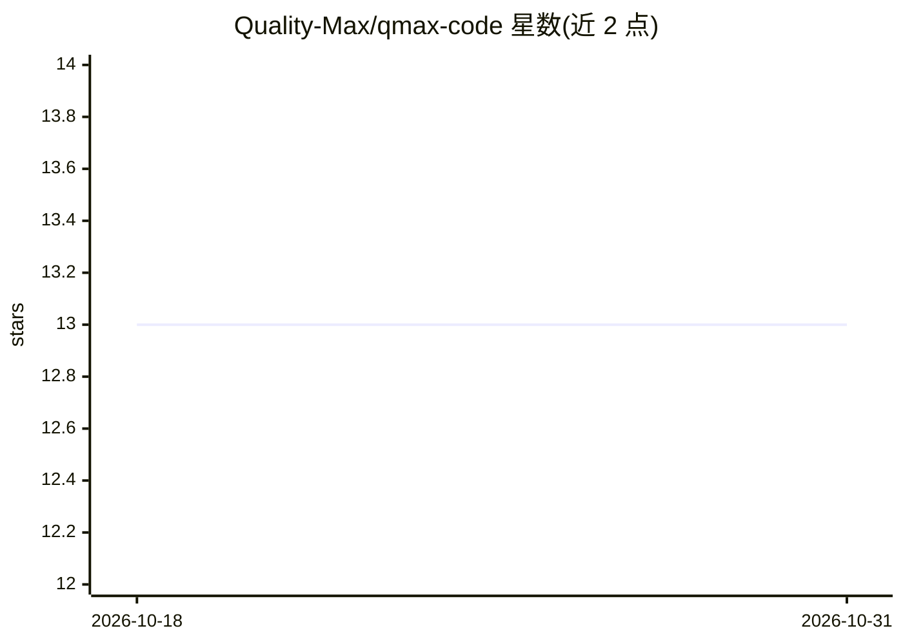

# Quality-Max/qmax-code

⭐ 13 · Go · Apache-2.0 · 推送 2026-10-22 · [GitHub](https://github.com/Quality-Max/qmax-code) · [官网](https://qualitymax.io/qmax-code) · 组织维护

**面向 QA 的终端 agent，编排多后端驱动测试/爬取/审查流程**

用 Go 编写的 QA 终端 agent，可独立作为本地仓库 agent 运行（无需 QualityMax 账号），或连接 QualityMax 云端使用项目/测试用例管理、爬取站点、生成并执行 Playwright/pytest/Go/Rust 测试、仓库质量与安全审查、选择器修复与 CI 工作流生成。内置 agent 支持 Anthropic、Cerebras、Ollama 推理，/orch 编排模式可宿主 Claude Code、Codex、Antigravity、OpenCode 并经 MCP 提供同一套 QA 工具；限制：独立模式工具仅为读写文件与运行命令，云端功能需登录。

## 筛选速览

| 维度 | 判定 | 备注 |
|---|---|---|
| AI 角色 | `ai-ecosystem` | LLM/agent 周边工具 |
| 许可风险 | `permissive` | Apache-2.0 |
| 部署形态 | `library` | 以包/库形式分发 |
| 模型依赖 | local-ok | 支持本地模型 |
| 硬件要求 | — | 无带数字的原话,不猜 |
| 安装摩擦 | `low` | 无编译、无系统依赖或容器化 |
| 成熟度 | `idea` | |

## 能力要点

- 独立本地模式无需 QualityMax 账号即可读写仓库、运行命令
- /orch 编排：单一会话内切换 Claude Code/Codex/Antigravity/OpenCode 等 CLI 后端，经 MCP 提供工具
- 生成并执行 Playwright/pytest/Go/Rust 测试，含爬取、覆盖率与安全审查
- 随附 QA 技能目录（可访问性、性能、SEO、依赖、发布门禁等），可安装进其他 coding agent

## 适用场景

- 在终端里对本地仓库做测试生成、执行与质量审查
- 连接 QualityMax 托管项目、爬取站点并生成 e2e 测试
- 通过 /orch 在快推理后端与 Claude Code/Codex 间切换完成编码与设计任务
- 将 QA 技能集安装到已有 coding agent 中

## 场景标签

`编码 Agent` `代码审查` · 领域:编码与开发

## 证据(README 行号)

> L29: Use the built-in agent with Anthropic, Cerebras, or Ollama, or use
> L239: For CLI backends, qmax-code launches the selected agent as a subprocess and
> L274: |Ollama|`/ollama` or `/orch`|Configured Ollama endpoint|Self-hosted inference; configure the URL and model first.|

## 星数曲线

2026-10-18 13 → 2026-10-31 13（+0）

---
*卡片 v1 · prompt 1.4 · 生成 2026-10-31 · 置信度 high · 依据 README sha `e2ae7b2bb5af` · [字段定义](../../DATASET.md)*
