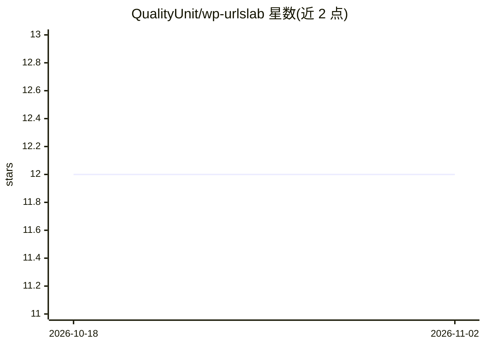

# QualityUnit/wp-urlslab

⭐ 12 · PHP · GPL-2.0 · 推送 2026-09-13 · [GitHub](https://github.com/QualityUnit/wp-urlslab) · [官网](https://www.urlslab.com) · 组织维护

**面向 WordPress 的 SEO/性能优化插件，含 AI 内容生成功能**

由 QualityUnit（LiveAgent、PostAffiliatePro 开发方）维护的 WordPress 插件，功能覆盖 SEO（大规模内链建设、外链交换、反链监控、AI 生成元描述与标题、FAQ 回答）、SERP 监控（数十万查询追踪、竞品内容差距分析）、内容注入与替换、缓存控制、安全（CSP、404 防护）、Web Vitals 监控及媒体卸载等。HTML 修改在请求时于内存 DOM 中进行，不改数据库原始内容，插件关闭后网站恢复原状；要求页面 HTML 有效，否则无法解析。插件免费安装，AI 内容与 SERP 监控等模块需付费 API 调用。

## 筛选速览

| 维度 | 判定 | 备注 |
|---|---|---|
| AI 角色 | `ai-enhanced` | 去掉 AI 部分产品仍成立 |
| 许可风险 | `viral` | GPL-2.0 |
| 部署形态 | `desktop` | 安装包/桌面程序 |
| 模型依赖 | — | README 未给出锁定关系 |
| 硬件要求 | — | 无带数字的原话,不猜 |
| 安装摩擦 | `low` | 无编译、无系统依赖或容器化 |
| 成熟度 | `idea` | |

## 能力要点

- 覆盖 SEO/SERP/内容/缓存/安全/优化等 30 余项功能的模块化插件
- AI 生成元描述、标题、内容、FAQ 回答与重定向建议
- 请求时内存 DOM 修改，不改数据库原始内容，可整体还原
- 支持 WordPress 市场、ZIP、wp cli、composer、git 多种安装方式

## 适用场景

- WordPress 站点做大规模内链建设与反链监控
- 用 AI 批量生成元描述、标题与 FAQ 内容
- 监控数十万关键词的 SERP 排名与竞品内容差距

## 场景标签

`AI 写作` · 领域:内容生成

## 证据(README 行号)

> L1: # URLsLab = ( SEO + PERFORMANCE + AI ) * IN_SCALE.
> L9: - SEO - AI-Generated Meta Descriptions and Titles
> L16: - CONTENT - AI-Generated Content in Scale

## 星数曲线

2026-10-18 12 → 2026-11-02 12（+0）

---
*卡片 v1 · prompt 1.4 · 生成 2026-11-01 · 置信度 high · 依据 README sha `2344e739c849` · [字段定义](../../DATASET.md)*
