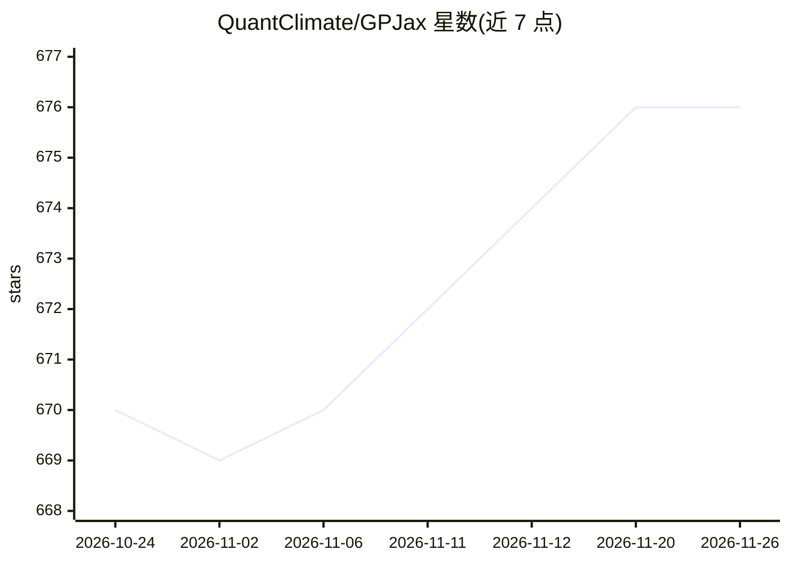

# QuantClimate/GPJax

⭐ 676 · Python · MIT · 推送 2026-11-25 · [GitHub](https://github.com/QuantClimate/GPJax) · [官网](https://gpjax.quantclimate.com) · 组织维护

**为科研人员提供 JAX 上的高斯过程建模接口**

GPJax 是构建于 JAX 之上的高斯过程模型库，定位为面向研究者的低层接口，代码结构贴近高斯过程的数学表达以便扩展。文档以 Notebook 示例组织，覆盖入门（核函数、回归、分类、计数数据回归）、加速方法（稀疏回归、随机变分推断、状态空间 GP、OILMM 多输出）、应用建模（图核、空间建模、海洋流建模、xarray 网格数据）及核/似然/深度核学习等自定义指南，示例以 py:percent 格式存储并可用 jupytext 与 .ipynb 互转。通过 JOSS 论文提供引用条目。

## 筛选速览

| 维度 | 判定 | 备注 |
|---|---|---|
| AI 角色 | `ai-native` | 本体是模型或模型工具 |
| 许可风险 | `permissive` | MIT |
| 部署形态 | `library` | 以包/库形式分发 |
| 模型依赖 | — | README 未给出锁定关系 |
| 硬件要求 | — | 无带数字的原话,不猜 |
| 安装摩擦 | `low` | 无编译、无系统依赖或容器化 |
| 成熟度 | — | 结构信号不足 |

## 能力要点

- JAX/Equinox 上的高斯过程低层接口，结构贴近数学表达
- 覆盖稀疏回归、随机变分推断、自然梯度、状态空间 GP 等加速方法
- 含图核、多输出、空间建模、海洋流等应用示例与核/似然自定义指南
- 提供 PyPI、conda-forge 安装途径与 JOSS 论文引用

## 适用场景

- 在 JAX 生态中构建和扩展高斯过程模型
- 用稀疏与变分方法处理大规模回归问题
- 做空间数据或海洋流等应用领域的高斯过程建模
- 作为教学示例学习核函数与 GP 推断

## 场景标签

`科研工具` · 领域:学习与行业

## 证据(README 行号)

> L16: GPJax aims to provide a low-level interface to Gaussian process (GP) models in
> L17: Jax, structured to give researchers maximum
> L22: # Package organisation

## 星数曲线

2026-10-24 670 → 2026-11-26 676（+6）

---
*卡片 v1 · prompt 1.4 · 生成 2026-11-26 · 置信度 high · 依据 README sha `017ca71f86d1` · [字段定义](../../DATASET.md)*
