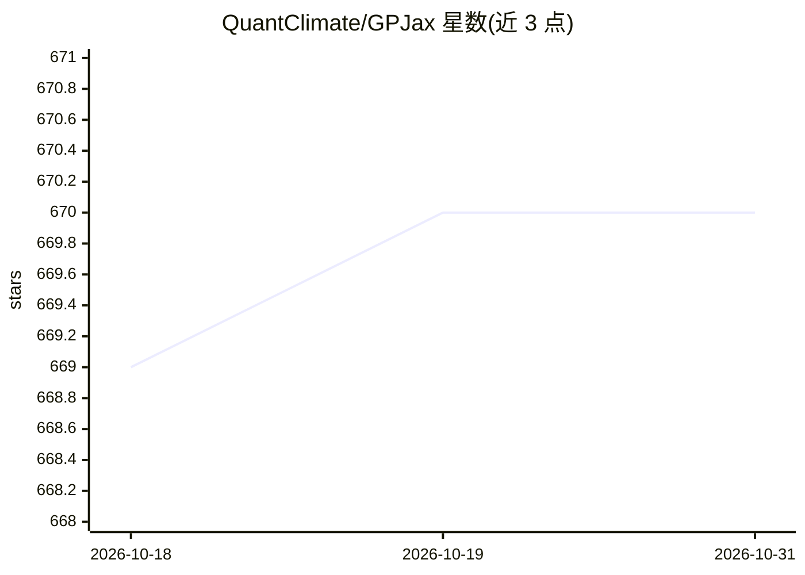

# QuantClimate/GPJax

⭐ 670 · Python · MIT · 推送 2026-10-27 · [GitHub](https://github.com/QuantClimate/GPJax) · [官网](https://gpjax.quantclimate.com) · 组织维护

**面向研究者的 JAX 高斯过程建模库**

GPJax 提供基于 JAX 与 Equinox 的高斯过程（GP）低层接口，代码结构贴近数学表达，供研究人员按需扩展。支持回归、分类、计数回归、稀疏 GP、随机变分推断、多输出 GP、图核、异方差推断、深度核学习等方法，并提供与 Numpyro 的联合推断示例。以 pip/conda 安装的 Python 库形式发布，配套 Notebook 示例库与文档，有 JOSS 论文可引用。开发版本存在不稳定与 bug 的可能。

## 筛选速览

| 维度 | 判定 | 备注 |
|---|---|---|
| AI 角色 | `ai-native` | 本体是模型或模型工具 |
| 许可风险 | `permissive` | MIT |
| 部署形态 | `library` | 以包/库形式分发 |
| 模型依赖 | — | README 未给出锁定关系 |
| 硬件要求 | — | 无带数字的原话,不猜 |
| 安装摩擦 | `low` | 无编译、无系统依赖或容器化 |
| 成熟度 | — | 结构信号不足 |

## 能力要点

- 低层 GP 接口，代码结构贴近数学推导，便于研究者扩展
- 覆盖稀疏 GP、变分推断、多输出 GP、图核等系列方法
- 提供 Notebook 示例库与 Numpyro 联合推断指南
- 通过 PyPI 与 conda-forge 分发稳定版

## 适用场景

- 研究中构建与扩展高斯过程回归/分类模型
- 做稀疏与可扩展 GP 变分推断实验
- 学习 GP 方法（核函数、似然、自然梯度）的示例教程
- 学术研究引用其 JOSS 论文复现方法

## 场景标签

`科研工具` · 领域:学习与行业

## 证据(README 行号)

> L16: GPJax aims to provide a low-level interface to Gaussian process (GP) models in
> L55: # Supported methods and interfaces

## 星数曲线

2026-10-18 669 → 2026-10-31 670（+1）

---
*卡片 v1 · prompt 1.4 · 生成 2026-10-21 · 置信度 high · 依据 README sha `cd197c8d0456` · [字段定义](../../DATASET.md)*
