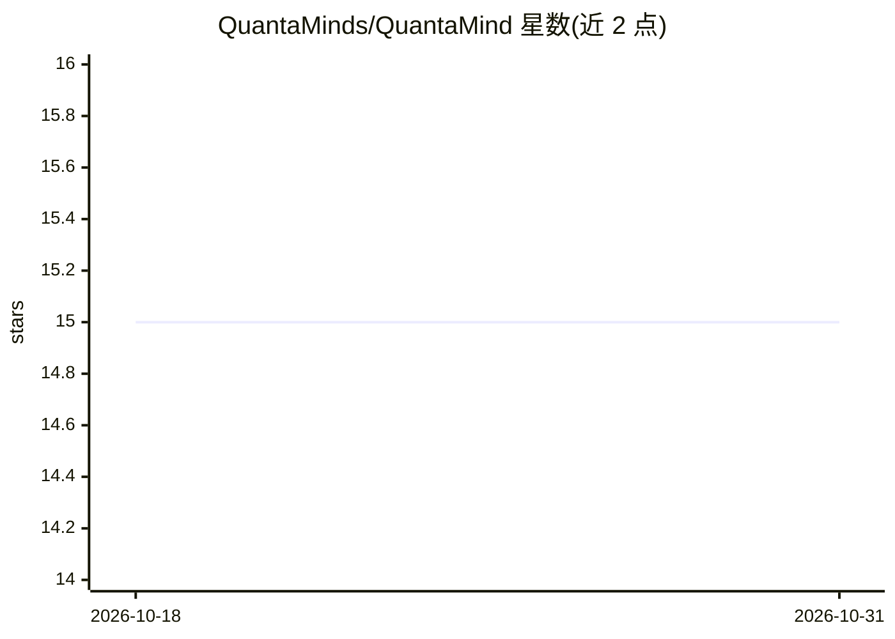

# QuantaMinds/QuantaMind

⭐ 15 · Rust · Apache-2.0 · 推送 2026-08-03 · [GitHub](https://github.com/QuantaMinds/QuantaMind) · [官网](https://www.quantamind.co/) · 组织维护

**本地 LLM 的 Agent 就绪度评测工作台，输出部署前裁决**

面向本地部署开发者的评测工作台：驱动 llama.cpp 或 vLLM 后端上的模型跑分层 Agent 任务（多步规划、工具调用、恢复），以 pass^k 评分并输出 Ready / Conditional / Not Ready 裁决，附失败模式分类与 VRAM 适配判定。默认全离线、无遥测，可选连接远程 vLLM GPU 服务器。提供桌面应用（Tauri 2.x）与 qm CLI，CLI 裁决直接映射为 CI 退出码，另有 qm certify 可把用户自有 agent 作为被测对象（不调用模型）。不进行训练或微调。

## 筛选速览

| 维度 | 判定 | 备注 |
|---|---|---|
| AI 角色 | `ai-ecosystem` | LLM/agent 周边工具 |
| 许可风险 | `permissive` | Apache-2.0 |
| 部署形态 | `None` |  |
| 模型依赖 | local-ok | 支持本地模型 |
| 硬件要求 | — | 无带数字的原话,不猜 |
| 安装摩擦 | `low` | 无编译、无系统依赖或容器化 |
| 成熟度 | — | 结构信号不足 |

## 能力要点

- llama.cpp / vLLM 后端上跑分层 Agent 任务并以 pass^k 评分
- Ready / Conditional / Not Ready 裁决含失败模式分类（FakeDone、LoopCap 等）
- qm CLI 裁决映射为 CI 退出码，附 GitHub Action 与容器镜像
- qm certify 以真实世界终态为评分对象，评测用户自有 agent

## 适用场景

- 把本地模型接入 agent 前先验证其在目标硬件上的可靠性
- 在 CI 流水线中用 qm run 做模型就绪度门禁
- 对比同一模型不同量化版本选出最小可用配置

## 场景标签

`模型评测` · 领域:评测与运维

## 证据(README 行号)

> L5: Benchmark any **llama.cpp** or **vLLM** model for *agentic readiness* on your own hardware — and get a **Ready / Con
> L144: $ qm run --k 8 --costs --save-report r.json --junit j.xml --save-transcripts traces/

## 星数曲线

2026-10-18 15 → 2026-10-31 15（+0）

---
*卡片 v1 · prompt 1.4 · 生成 2026-10-30 · 置信度 high · 依据 README sha `d904177cb53e` · [字段定义](../../DATASET.md)*
