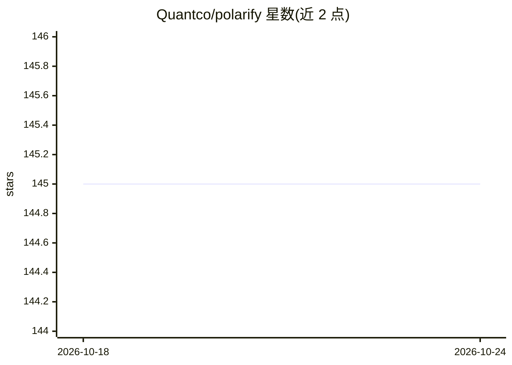

# Quantco/polarify

⭐ 147 · Python · BSD-3-Clause · 推送 2026-10-23 · [GitHub](https://github.com/Quantco/polarify) · 组织维护

**把 Python if/elif/else 转写为 Polars 表达式的装饰器库**

QuantCo 维护的 Python 库，核心是 @polarify 装饰器：解析函数的 AST，将 if/elif/else、赋值、match 等控制流内联转写为 pl.when().then().otherwise() 形式的 Polars 表达式，使逐行逻辑代码可用向量化表达式运行。另提供 transform_func_to_new_source 查看转写结果。仍处早期阶段，不支持 for/while 循环、walrus 操作符与带副作用的函数。面向使用 Polars 做数据处理的 Python 开发者，经 conda-forge 与 pip 安装。

## 筛选速览

| 维度 | 判定 | 备注 |
|---|---|---|
| AI 角色 | `ai-enhanced` | 去掉 AI 部分产品仍成立 |
| 许可风险 | `permissive` | BSD-3-Clause |
| 部署形态 | `library` | 以包/库形式分发 |
| 模型依赖 | — | README 未给出锁定关系 |
| 硬件要求 | — | 无带数字的原话,不猜 |
| 安装摩擦 | `low` | 无编译、无系统依赖或容器化 |
| 成熟度 | `idea` | |

## 能力要点

- 装饰器自动将 if/elif/else 转为 pl.when/then/otherwise 表达式
- 支持多语句、嵌套分支与 match 语句的转写
- 基于 AST 解析与分支内联实现
- 可调用 transform_func_to_new_source 显示转写后的表达式源码

## 适用场景

- 用自然 Python 写法编写逐行条件逻辑并跑在 Polars 向量化表达式上
- 减少手写嵌套 when/then 链，让条件代码可读
- 查看转写结果以理解生成的 Polars 表达式

## 场景标签

 · 领域:数据处理/编程工具库

## 证据(README 行号)

> L10: Welcome to **polarIFy**, a Python function decorator that simplifies the way you write logical statements for Polar
> L97: polarIFy achieves this by parsing the AST (Abstract Syntax Tree) of the function and transforming the body into a P

## 星数曲线

2026-10-18 145 → 2026-10-24 145（+0）

---
*卡片 v1 · prompt 1.4 · 生成 2026-10-22 · 置信度 low · 依据 README sha `87f8d9b0c915` · [字段定义](../../DATASET.md)*
