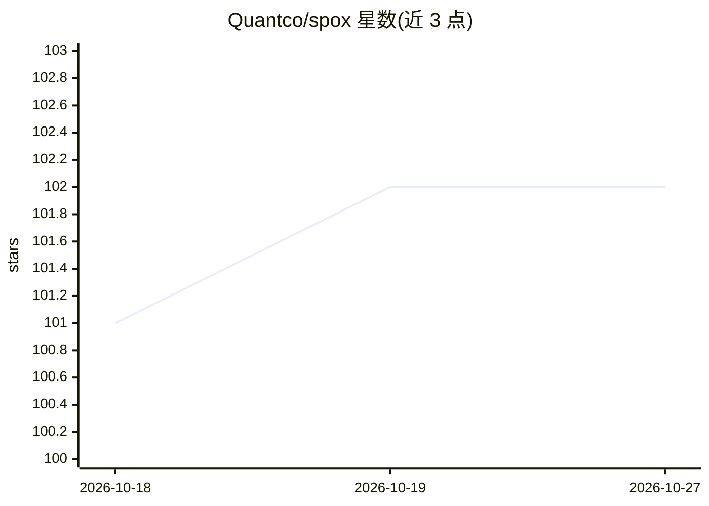

# Quantco/spox

⭐ 102 · Python · BSD-3-Clause · 推送 2026-10-26 · [GitHub](https://github.com/Quantco/spox) · [官网](https://spox.readthedocs.io/en/latest/) · 组织维护

**用 Python 代码构建 ONNX 模型图的库**

面向需要以编程方式构建 ONNX 模型的开发者的 Python 框架：以 Var 变量对象为核心抽象，通过 argument 函数声明带类型的模型输入，调用覆盖 ONNX 标准全部算子的函数逐步构图，最终经 spox.build 生成 onnx.ModelProto。特色包括算子的即时验证与类型推断、带 Python 回溯的错误定位、对子图（控制流）的一级支持。主要用途是从各框架向 ONNX 编写转换器。通过 PyPI 与 conda-forge 提供。

## 筛选速览

| 维度 | 判定 | 备注 |
|---|---|---|
| AI 角色 | `ai-ecosystem` | LLM/agent 周边工具 |
| 许可风险 | `permissive` | BSD-3-Clause |
| 部署形态 | `library` | 以包/库形式分发 |
| 模型依赖 | — | README 未给出锁定关系 |
| 硬件要求 | — | 无带数字的原话,不猜 |
| 安装摩擦 | `low` | 无编译、无系统依赖或容器化 |
| 成熟度 | — | 结构信号不足 |

## 能力要点

- 以 Var 变量抽象构建 ONNX 图，最终产出 onnx.ModelProto
- 算子即时验证与类型推断，错误带 Python 回溯定位
- 对子图（控制流）一级支持
- 提供覆盖 ONNX 标准全部算子的函数（spox.opset）

## 适用场景

- 把其他框架的模型行为复刻为 ONNX 算子图，编写转换器
- 以类型安全的方式程序化生成 ONNX 模型
- 构建含控制流的子图结构模型

## 场景标签

 · 领域:机器学习/模型互操作

## 证据(README 行号)

> L6: Spox makes it easy to construct ONNX models through clean and idiomatic Python code.
> L12: Based on our experience, we designed Spox from the ground up to make the process of writing converters (and ONNX mo

## 星数曲线

2026-10-18 101 → 2026-10-27 102（+1）

---
*卡片 v1 · prompt 1.4 · 生成 2026-10-23 · 置信度 high · 依据 README sha `4775609431cf` · [字段定义](../../DATASET.md)*
