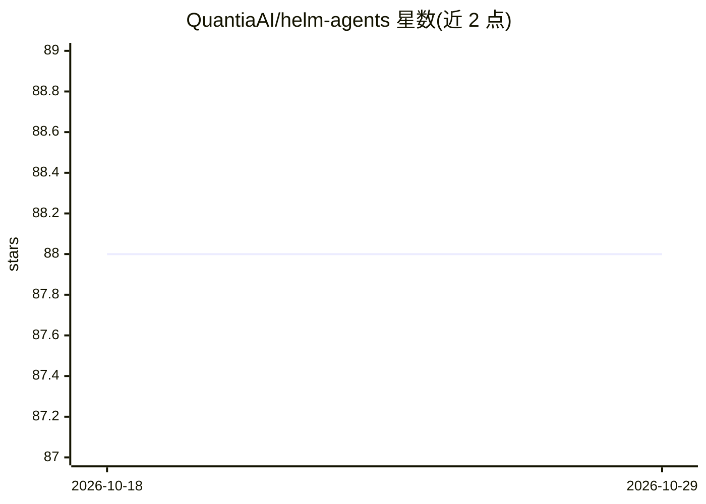

# QuantiaAI/helm-agents

⭐ 88 · TypeScript · Apache-2.0 · 推送 2026-06-23 · [GitHub](https://github.com/QuantiaAI/helm-agents) · 个人维护 · 中文 README

**多智能体 LLM 股票/加密交易决策台：13 位分析师辩论收敛出交易决策**

TypeScript 原生（NestJS API + React/Vite SPA）的多智能体交易分析应用：给定代码与交易日期，13 个 LLM 智能体（行情/情绪/新闻/基本面分析师、多空辩论、交易员、风险辩论、组合经理）经 LangGraph.js StateGraph 流水线产出五档交易决策，全程实时流式推演并持久化，可导出 Markdown。支持 20 家 provider（OpenAI 兼容家族 + Anthropic/Google），提供 DEMO 模式（stub LLM 无需密钥）。多租户认证，API 密钥 AES-256-GCM 加密落盘。声明输出仅供研究教育、非投资建议；README 含交易所返佣推荐链接。

## 筛选速览

| 维度 | 判定 | 备注 |
|---|---|---|
| AI 角色 | `ai-native` | 本体是模型或模型工具 |
| 许可风险 | `permissive` | Apache-2.0 |
| 部署形态 | `self-host` | docker 或自建部署 |
| 模型依赖 | — | README 未给出锁定关系 |
| 硬件要求 | — | 无带数字的原话,不猜 |
| 安装摩擦 | `low` | 无编译、无系统依赖或容器化 |
| 成熟度 | — | 结构信号不足 |

## 能力要点

- 13 智能体流水线产出五档交易决策，附完整推理可追溯
- 浏览器实时流式时间线，运行记录可导出 Markdown
- 20 家 LLM provider 注册表，不绑定单一厂商
- DEMO_LLM=1 模式无需 API 密钥跑通完整流水线

## 适用场景

- 输入股票代码与日期，让多智能体产出去中心化的交易研究分析
- 实时观看分析师采集与多空、风险辩论的完整推理过程
- 本地部署并自带模型密钥，在多账户隔离环境下运行分析

## 场景标签

`多智能体` `金融量化` · 领域:Agent 开发

## 证据(README 行号)

> L48: 给定 `(代码, 交易日期)`，一条 13 智能体流水线产出一个五档交易决策（**买入 / 增持 / 持有 / 减持 / 卖出**），附带完整支撑分析：
> L61: 流水线以 LangGraph.js `StateGraph` 运行，并在每个智能体完成时把 `nodeEnd` 事件流式推送到浏览器。分析师内联预取数据（输出与原项目的工具调用循环等价，但省去额外往返），每份报告、辩论全文与最终决

## 星数曲线

2026-10-18 88 → 2026-10-29 88（+0）

---
*卡片 v1 · prompt 1.4 · 生成 2026-10-23 · 置信度 mid · 依据 README sha `98ab8dcdf54d` · [字段定义](../../DATASET.md)*
