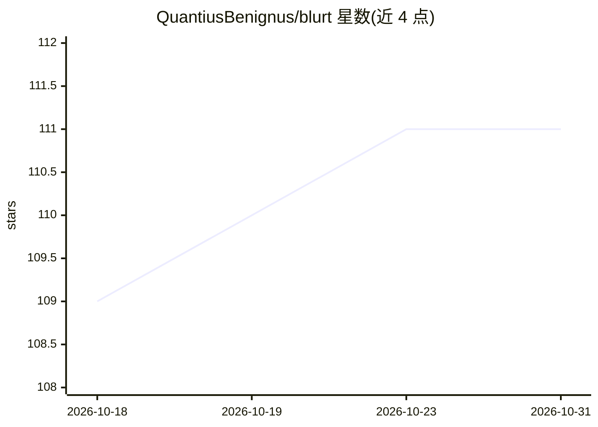

# QuantiusBenignus/blurt

⭐ 111 · JavaScript · GPL-3.0 · 推送 2026-05-07 · [GitHub](https://github.com/QuantiusBenignus/blurt) · [官网](https://extensions.gnome.org/extension/6742/blurt/) · 个人维护

**GNOME Shell 离线语音转文字输入扩展**

基于 whisper.cpp 的 GNOME Shell 扩展，通过快捷键或点击顶栏图标触发录音，用 sox 以 16kHz 采集语音，交给本地 whisper.cpp（whisper-cli/whisper-server）、远程 whisper.cpp 服务器或 whisperfile（llamafile 便携可执行文件）转写，结果经清理格式化后送入 X11/Wayland 剪贴板或 PRIMARY selection，可在任意可编辑字段粘贴。支持 GNOME Shell 49 及以下版本，可从 GNOME 扩展网站一键安装或手动克隆安装，需自行配置 wsi 编排脚本与推理引擎。

## 筛选速览

| 维度 | 判定 | 备注 |
|---|---|---|
| AI 角色 | `ai-native` | 本体是模型或模型工具 |
| 许可风险 | `viral` | GPL-3.0 |
| 部署形态 | `None` |  |
| 模型依赖 | — | README 未给出锁定关系 |
| 硬件要求 | — | 无带数字的原话,不猜 |
| 安装摩擦 | `medium` | 含编译或系统依赖之一 |
| 成熟度 | — | 结构信号不足 |

## 能力要点

- 本地 whisper.cpp / whisper.cpp 服务器 / whisperfile 三种转写通道
- 快捷键或图标点击启停，结果送剪贴板可在任意输入框粘贴
- whisper 多语言模型支持，可固定语言代码
- 自动粘贴可用 xdotool 实现

## 适用场景

- 在 Linux 桌面任意应用中用语音输入文字
- 离线（不联网）语音听写与听写式录入
- 远程服务器统一承载 whisper.cpp 推理的听写工作流

## 场景标签

`语音识别` · 领域:感知与多模态

## 证据(README 行号)

> L5: **Blurt** is a simple Gnome shell extension based on the command line utility NoteWhispers, which itself, is built a
> L19: When Blurt is enabled (indicated with &#x1E04; in the top bar), one can input text from speech into any editable fi

## 星数曲线

2026-10-18 109 → 2026-10-31 111（+2）

---
*卡片 v1 · prompt 1.4 · 生成 2026-10-23 · 置信度 high · 依据 README sha `19c201021649` · [字段定义](../../DATASET.md)*
