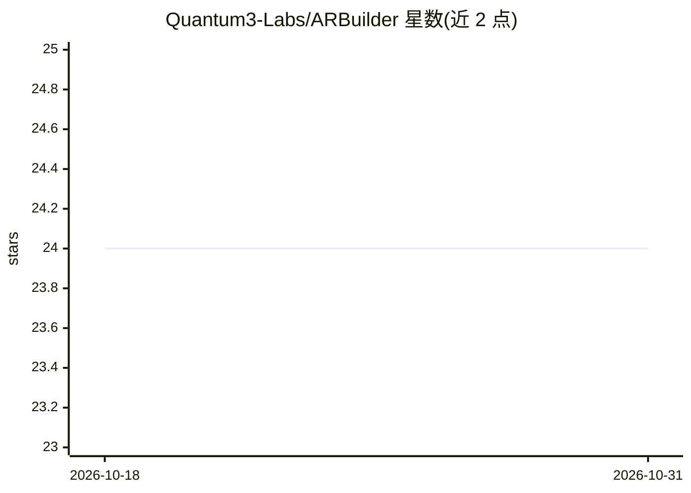

# Quantum3-Labs/ARBuilder

⭐ 24 · TypeScript · MIT · 推送 2026-05-08 · [GitHub](https://github.com/Quantum3-Labs/ARBuilder) · [官网](https://arbuilder.app) · 组织维护

**面向 Arbitrum 生态的 AI 代码生成 MCP 服务器，含 RAG 检索**

为 Arbitrum 生态开发提供的 MCP 服务器（19 个工具、11 个资源、5 个提示），把自然语言需求转换为 Stylus 智能合约（Rust）、跨链 SDK 实现、全栈 dApp 与 Orbit 链部署辅助。机制：RAG 管线（向量 + BM25 + cross-encoder 重排）检索 84 个策展数据源（53 文档页 + 31 仓库），支持按 Stylus SDK 版本（0.8.0–0.10.0）定向生成；本地自托管需 Conda 环境并生成 ChromaDB 向量库，另有 arbuilder.app 托管服务（免费层每日 100 次调用），并提供 OpenAI 兼容的 Chat Completions 端点。

## 筛选速览

| 维度 | 判定 | 备注 |
|---|---|---|
| AI 角色 | `ai-ecosystem` | LLM/agent 周边工具 |
| 许可风险 | `permissive` | MIT |
| 部署形态 | `self-host` | docker 或自建部署 |
| 模型依赖 | locked-api |  |
| 硬件要求 | — | 无带数字的原话,不猜 |
| 安装摩擦 | `low` | 无编译、无系统依赖或容器化 |
| 成熟度 | — | 结构信号不足 |

## 能力要点

- 19 个 MCP 工具覆盖 Stylus 合约、Orbit 链配置与部署、dApp 脚手架
- RAG 混合检索（向量 + BM25 + cross-encoder 重排）基于 84 个策展数据源
- 按 Stylus SDK 版本（0.8.x/0.9.x/0.10.0）定向生成与检索
- 提供托管服务与 OpenAI 兼容 Chat Completions API（ReAct agent）

## 适用场景

- 在 Cursor / Claude 等 IDE 中生成 Stylus 智能合约与测试
- 生成跨链资产桥接与消息传递的 SDK 实现代码
- 获取 Orbit 链配置、部署与验证器设置的脚手架

## 场景标签

`代码生成` `RAG` · 领域:编码与开发

## 证据(README 行号)

> L15: AI-powered development assistant for the Arbitrum ecosystem. ARBuilder transforms natural language prompts into:
> L50: ARBuilder uses a **Retrieval-Augmented Generation (RAG)** pipeline with hybrid search (vector + BM25 + cross-encode
> L126: Capabilities: 19 tools, 11 resources, 5 prompts

## 星数曲线

2026-10-18 24 → 2026-10-31 24（+0）

---
*卡片 v1 · prompt 1.4 · 生成 2026-10-27 · 置信度 mid · 依据 README sha `2d6a0340e7d8` · [字段定义](../../DATASET.md)*
