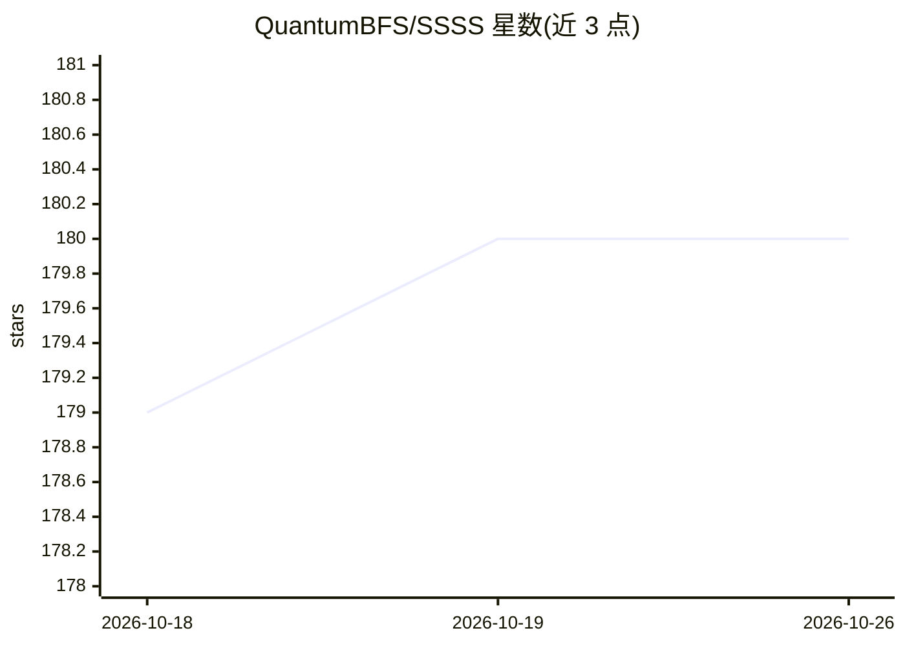

# QuantumBFS/SSSS

⭐ 180 · Jupyter Notebook · MIT · 推送 2026-09-08 · [GitHub](https://github.com/QuantumBFS/SSSS) · [官网](http://sbisc.sslab.org.cn/programs.php) · 组织维护 · 中文 README

**松山湖“深度学习与量子编程”春季学校课程材料仓库**

2019 年 5 月在东莞松山湖材料实验室举办的春季学校资料仓库，内容含讲义、编程挑战、安装指南与 Julia 中文教程。技术栈为 Julia 语言与 Yao.jl 量子计算框架，配合 PyTorch 等深度学习工具。仓库本身可作为 Julia 包添加，通过 notebooks() 函数打开课程 notebook。代码以 MIT 许可发布，其余内容以 CC BY-NC-SA 4.0 发布。

## 筛选速览

| 维度 | 判定 | 备注 |
|---|---|---|
| AI 角色 | `ai-knowledge` | 知识聚合/清单类 |
| 许可风险 | `permissive` | MIT |
| 部署形态 | `None` |  |
| 模型依赖 | — | README 未给出锁定关系 |
| 硬件要求 | — | 无带数字的原话,不猜 |
| 安装摩擦 | `low` | 无编译、无系统依赖或容器化 |
| 成熟度 | — | 结构信号不足 |

## 能力要点

- 含课程讲义、编程挑战与安装指南（Ubuntu/Anaconda/PyTorch/Julia/Yao.jl）
- 可作为 Julia 包添加并通过 notebooks() 打开课程 notebook
- 提供 Julia 语言中文入门教程

## 适用场景

- 参加或回看 2019 松山湖春季学校课程
- 学习 Julia 与 Yao.jl 量子编程
- 准备深度学习与量子计算交叉方向的开发环境

## 场景标签

`教程课程` · 领域:学习与行业

## 证据(README 行号)

> L1: # Deep Learning and Quantum Programming: A Spring School
> L5: Song Shan Lake Spring School, features lectures, code challenge, install party and happy fatty night.

## 星数曲线

2026-10-18 179 → 2026-10-26 180（+1）

---
*卡片 v1 · prompt 1.4 · 生成 2026-10-22 · 置信度 high · 依据 README sha `3a80a75a9102` · [字段定义](../../DATASET.md)*
