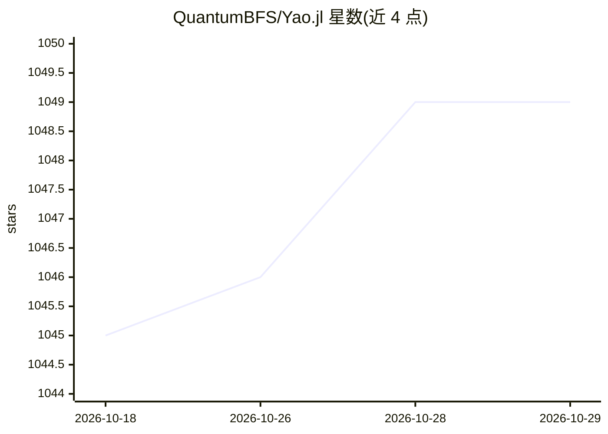

# QuantumBFS/Yao.jl

⭐ 1,049 · Julia · NOASSERTION · 推送 2026-10-15 · [GitHub](https://github.com/QuantumBFS/Yao.jl) · [官网](https://yaoquantum.org) · 组织维护 · 中文 README

**Julia 量子算法设计框架，服务量子信息科研与教学**

Yao 是用 Julia 语言编写的开源量子计算框架，面向量子算法设计、量子软件研究与量子计算教学场景。提供 Quantum Blocks 方式定义量子线路（如 3 行代码实现量子傅里叶变换），配套算法动物园 QuAlgorithmZoo 与教程文档。支持通过 Julia 包管理器安装，CUDA 加速由 CuYao.jl 提供，张量网络模拟由 YaoToEinsum.jl 提供。README 自述处于早期 beta 阶段。

## 筛选速览

| 维度 | 判定 | 备注 |
|---|---|---|
| AI 角色 | `ai-ecosystem` | LLM/agent 周边工具 |
| 许可风险 | `none` | NOASSERTION |
| 部署形态 | `None` |  |
| 模型依赖 | — | README 未给出锁定关系 |
| 硬件要求 | — | 无带数字的原话,不猜 |
| 安装摩擦 | `medium` | 含编译或系统依赖之一 |
| 成熟度 | `idea` | |

## 能力要点

- Quantum Blocks 定义量子线路，3 行实现 QFT
- 配套 QuAlgorithmZoo 算法实现集合与教程文档
- 可选 CuYao.jl CUDA 支持与 YaoToEinsum.jl 张量网络模拟
- Apache 2 许可，Unitary Fund 资助项目

## 适用场景

- 用量子线路搭建与仿真开展量子算法研究
- 教学中演示量子计算概念与算法
- 将 Yao 作为基础框架编写新的量子算法实现

## 场景标签

`科研工具` `教程课程` · 领域:学习与行业

## 证据(README 行号)

> L16: Yao is an open source framework that aims to empower quantum information research with software tools. It is design
> L18: - quantum algorithm design;

## 星数曲线

2026-10-18 1,045 → 2026-10-29 1,049（+4）

---
*卡片 v1 · prompt 1.4 · 生成 2026-10-21 · 置信度 high · 依据 README sha `6b0a16cf72fe` · [字段定义](../../DATASET.md)*
