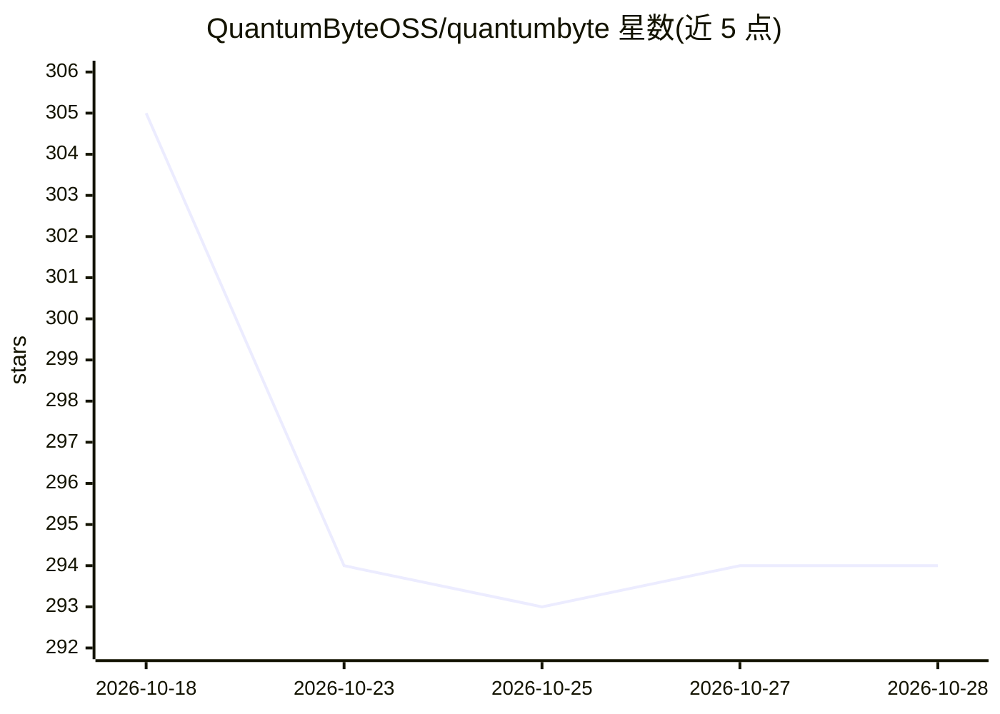

# QuantumByteOSS/quantumbyte

⭐ 294 · Python · Apache-2.0 · 推送 2026-10-23 · [GitHub](https://github.com/QuantumByteOSS/quantumbyte) · [官网](https://quantumbyte.ai) · 组织维护

**从意图生成可用应用并逐条验证需求的开源应用构建引擎**

开源的应用构建引擎：用户通过对话表达意图，agent 生成应用并放入独立项目仓库，每个 agent 回合后由独立的只读 harness 按业务需求逐条审计，返回带证据的 SUCCESS/FAIL/INCONCLUSIVE 结构化判定，支持差异范围重验证与后台运行。面向愿意参与早期共建的开发者与研究者，当前为公开 alpha。运行需 Docker、Node.js 20+、Python 3.11+ 与 Anthropic API key，worker 基于 Claude Agent SDK，多模型支持在路线图中。

## 筛选速览

| 维度 | 判定 | 备注 |
|---|---|---|
| AI 角色 | `ai-native` | 本体是模型或模型工具 |
| 许可风险 | `permissive` | Apache-2.0 |
| 部署形态 | `self-host` | docker 或自建部署 |
| 模型依赖 | locked-api |  |
| 硬件要求 | — | 无带数字的原话,不猜 |
| 安装摩擦 | `low` | 无编译、无系统依赖或容器化 |
| 成熟度 | `idea` | |

## 能力要点

- 意图→构建→验证→证据→修复/就绪的持续循环
- 独立只读 harness 按业务需求逐条审计并返回带证据的结构化判定
- 实时应用预览、健康检查与设备框架
- 构建恢复、worker 协调与项目亲和性

## 适用场景

- 用对话从业务意图生成可运行的应用
- 对 AI 生成应用逐条核验业务需求是否满足
- 检查生成应用与原始意图的一致性并按证据决定是否可交付

## 场景标签

`Agent 框架` `代码生成` · 领域:Agent 开发

## 证据(README 行号)

> L6:  Generate a working app from intent, then verify every agent turn against its business requirements.
> L51: - Agent-generated applications in dedicated project repositories

## 星数曲线

2026-10-18 305 → 2026-10-28 294（-11）

---
*卡片 v1 · prompt 1.4 · 生成 2026-10-21 · 置信度 high · 依据 README sha `733c1276ab5d` · [字段定义](../../DATASET.md)*
