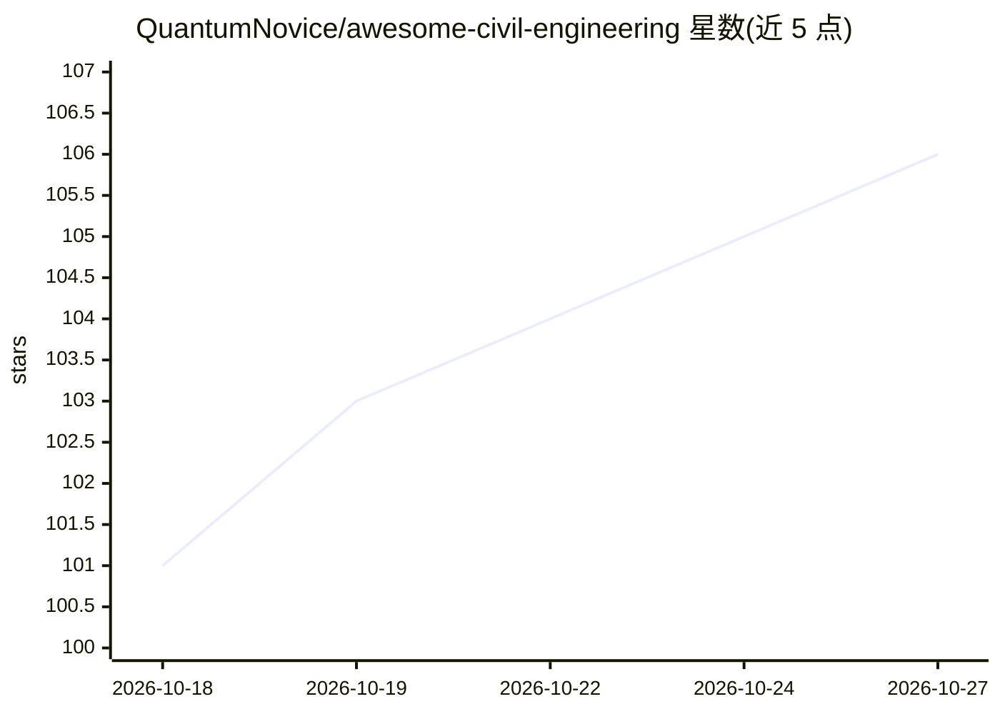

# QuantumNovice/awesome-civil-engineering

⭐ 106 · Python · CC0-1.0 · 推送 2026-10-24 · [GitHub](https://github.com/QuantumNovice/awesome-civil-engineering) · 个人维护

**土木工程软件与编程资源策展清单，覆盖多工程子领域**

Awesome 系列的土木工程软件资源清单：按报告文档、水资源与排水、结构分析与设计、结构仿真、岩土工程、交通工程、环境工程、数字孪生与 BIM 等类别组织条目，收录商业软件（SAP2000、PLAXIS、PTV Vissim）与开源工具（OpenFOAM、OpenSees、EPA SWMM、OSMnx 等），每条目附一句话功能说明。面向土木工程及相关领域的工程师与研究人员，用于软件选型与工具发现。清单型仓库，无安装运行本体。

## 筛选速览

| 维度 | 判定 | 备注 |
|---|---|---|
| AI 角色 | `ai-knowledge` | 知识聚合/清单类 |
| 许可风险 | `viral` | CC0-1.0 |
| 部署形态 | `None` |  |
| 模型依赖 | — | README 未给出锁定关系 |
| 硬件要求 | — | 无带数字的原话,不猜 |
| 安装摩擦 | `medium` | 含编译或系统依赖之一 |
| 成熟度 | — | 结构信号不足 |

## 能力要点

- 按 8 个土木工程子领域分类组织条目
- 同时收录商业软件与开源/免费工具
- 覆盖水力、结构、岩土、交通、环境、BIM/数字孪生等领域

## 适用场景

- 按工程子领域查找分析与设计软件
- 发现可用于土木工程的开源工具与 Python 包
- 比较商业与免费方案做软件选型

## 场景标签

`精选清单` · 领域:学习与行业

## 证据(README 行号)

> L1: # Awesome Civil Engineering Awesome
> L5: ## Contents

## 星数曲线

2026-10-18 101 → 2026-10-27 106（+5）

---
*卡片 v1 · prompt 1.4 · 生成 2026-10-23 · 置信度 high · 依据 README sha `3636a3a54096` · [字段定义](../../DATASET.md)*
