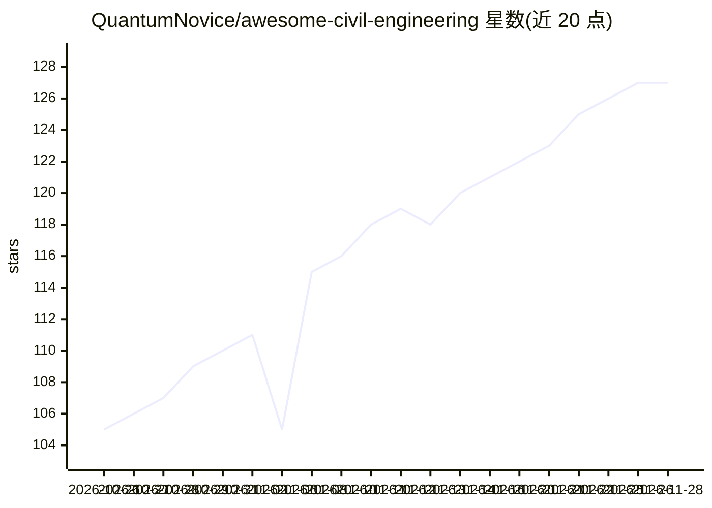

# QuantumNovice/awesome-civil-engineering

⭐ 127 · Python · CC0-1.0 · 推送 2026-11-24 · [GitHub](https://github.com/QuantumNovice/awesome-civil-engineering) · 个人维护

**土木工程软件与编程资源分类清单**

按土木工程子领域组织的资源清单，条目覆盖报告文档、水资源与排水、结构分析与设计、结构仿真、岩土工程、交通工程等类别，逐条以一句话描述各软件的用途与来源（商业或开源）。条目既包含 EPA SWMM、EPANET、OpenSees、FEniCSx、Code_Aster 等开源软件，也收录 SAP2000、ETABS、PLAXIS、Ansys 等商业软件。README 声明欢迎贡献（contributions-welcome 主题标签）。

## 筛选速览

| 维度 | 判定 | 备注 |
|---|---|---|
| AI 角色 | `ai-knowledge` | 知识聚合/清单类 |
| 许可风险 | `viral` | CC0-1.0 |
| 部署形态 | `None` |  |
| 模型依赖 | — | README 未给出锁定关系 |
| 硬件要求 | — | 无带数字的原话,不猜 |
| 安装摩擦 | `medium` | 含编译或系统依赖之一 |
| 成熟度 | — | 结构信号不足 |

## 能力要点

- 按子领域分类组织的软件条目清单
- 同时收录开源与商业土木工程软件
- 每条附一句话用途描述

## 适用场景

- 查找某一土木子领域的可用软件
- 寻找有限元、水力建模等方向的开源替代
- 作为课程或项目选型时的资源索引

## 场景标签

`精选清单` · 领域:学习与行业

## 证据(README 行号)

> L1: # Awesome Civil Engineering Awesome
> L5: ## Contents
> L54: ## Structural Analysis & Design Software

## 星数曲线

2026-10-26 105 → 2026-11-28 127（+22）

---
*卡片 v1 · prompt 1.4 · 生成 2026-11-28 · 置信度 high · 依据 README sha `5fc3fcb7481a` · [字段定义](../../DATASET.md)*
