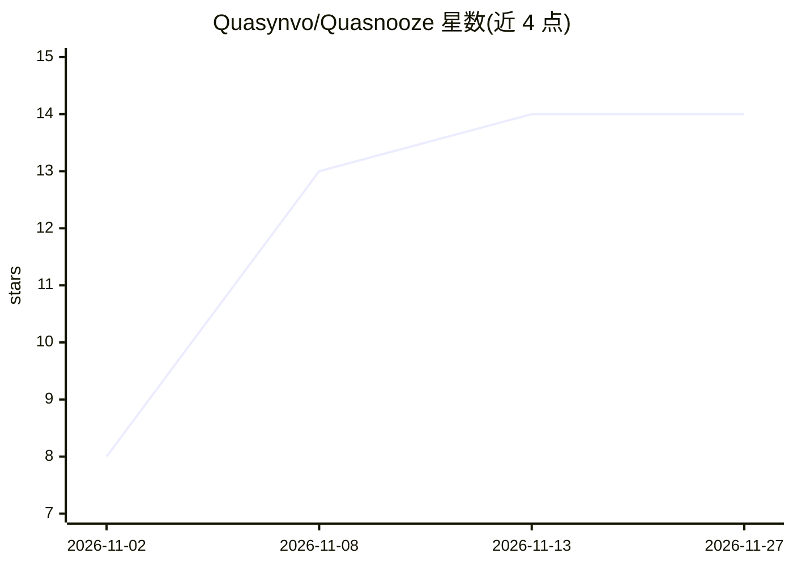

# Quasynvo/Quasnooze

⭐ 14 · JavaScript · MIT · 推送 2026-11-26 · [GitHub](https://github.com/Quasynvo/Quasnooze) · [官网](https://quasynvo.github.io/Quasnooze/) · 个人维护

**本地优先的个人 AI 语音助手，多渠道接入**

运行在用户自己电脑上的个人 AI 助手：本地推理来自 Ollama，提供网页面板、Windows 语音宿主、CLI 及 Telegram/Discord/Slack/WhatsApp 渠道。内置 37 个工具并支持 MCP 服务器；操作按风险分级，敏感操作需 Allow/Deny 确认，执行结果读回校验并标记 verified/contradicted/unverified。确定性快速路径处理常见意图（约 4ms，无需模型调用）。依赖 Node.js 22+，零运行时依赖，MIT 许可；Windows 原生语音宿主仅限 Windows 10/11。

## 筛选速览

| 维度 | 判定 | 备注 |
|---|---|---|
| AI 角色 | `ai-native` | 本体是模型或模型工具 |
| 许可风险 | `permissive` | MIT |
| 部署形态 | `library` | 以包/库形式分发 |
| 模型依赖 | local-ok | 支持本地模型 |
| 硬件要求 | — | 无带数字的原话,不猜 |
| 安装摩擦 | `low` | 无编译、无系统依赖或容器化 |
| 成熟度 | — | 结构信号不足 |

## 能力要点

- Ollama 本地推理，无需云账号，各渠道与云服务独立 opt-in
- 风险分级权限门：敏感操作预览后 Allow once/Deny，结果读回校验
- 确定性快速路径 p50 4.3ms，31/31 意图命中、0/28 近似误触发
- 37 个内置工具 + 自定义工具与 MCP 服务器接入

## 适用场景

- 在不联网的情况下用语音或文字管理提醒、任务与本地记忆
- 通过 Telegram/Discord 等聊天渠道接入个人助手
- 让助手检索本地文档并给出可引用来源
- 对文件整理等批量操作先审批计划再执行并支持撤销

## 场景标签

`AI 助手` `语音 Agent` · 领域:对话与助手

## 证据(README 行号)

> L6:  A local-first personal AI assistant by Quasynvo — Ollama + MCP tools,
> L23: **Quasnooze** is a personal AI assistant that runs on **your own computer**. Ask a question, plan your day, search 
> L37: - **Surfaces** — web panel, Windows tray/voice host, CLI, Telegram, Discord, Slack, WhatsApp

## 星数曲线

2026-11-02 8 → 2026-11-27 14（+6）

---
*卡片 v1 · prompt 1.4 · 生成 2026-11-18 · 置信度 high · 依据 README sha `057e9d37721f` · [字段定义](../../DATASET.md)*
