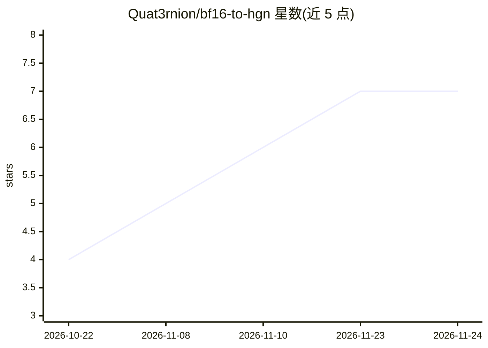

# Quat3rnion/bf16-to-hgn

⭐ — · [GitHub]() · 个人维护

**面向 Qwen3.8 Flash-Next 权重的 Rust 格式转换 CLI**

独立 Rust 命令行工具，内含 vendored C++ trellis 编码器，在 HF safetensors（BF16）、HGN 与 GGUF 三种格式间互相转换，默认输出 v2 profile，可选 ht43。仅接受完整的 Qwen3.8 Flash-Next（model_type=qwen4_exp）权重，其他架构与量化 safetensors 在发布前报错。默认构建仅依赖 Linux、Rust 1.85+ 与支持 OpenMP 的 C++17 编译器，无需 GPU 或 Python；HIP/CUDA 为可选 feature，用于 I4R 与 HT 解码加速。README 声明格式兼容不等于推理质量已验证。

## 筛选速览

| 维度 | 判定 | 备注 |
|---|---|---|
| AI 角色 | `ai-ecosystem` | LLM/agent 周边工具 |
| 许可风险 | `permissive` | — |
| 部署形态 | `None` |  |
| 模型依赖 | — | README 未给出锁定关系 |
| 硬件要求 | `cpu-ok` | |
| 安装摩擦 | `high` | 编译与系统依赖俱全 |
| 成熟度 | — | 结构信号不足 |

## 能力要点

- HF safetensors / HGN / GGUF 三种输入格式互转，穷举支持的 GGUF 量化类型清单
- 默认 CPU 构建，可选 HIP（gfx1151）与 CUDA（--features cuda）编码与验证后端
- verify 子命令基于 conversion-manifest.json 做 SHA-256/XOR 与布局校验
- 终端 indicatif 进度块按阶段/专家/行对粒度展示转换进度

## 适用场景

- 把 Unsloth UD 混合量化 GGUF 包导入为 HGN v2 格式
- 将 BF16 safetensors 快照目录转换为原生 HGN 存储
- 转换后对输出文件做哈希与布局校验

## 场景标签

 · 领域:LLM 基础设施/模型转换工具

## 证据(README 行号)

> L3: A standalone Rust CLI with a vendored C++ trellis encoder. The default
> L98: Linux, Rust 1.85 or newer, a C++17 compiler with OpenMP (for example GCC and
> L119: For optional AMD GPU encoding and verification, build with ROCm/HIP

## 星数曲线

2026-10-22 4 → 2026-11-24 7（+3）

---
*卡片 v1 · prompt 1.4 · 生成 2026-11-20 · 置信度 high · 依据 README sha `67637549524a` · [字段定义](../../DATASET.md)*
