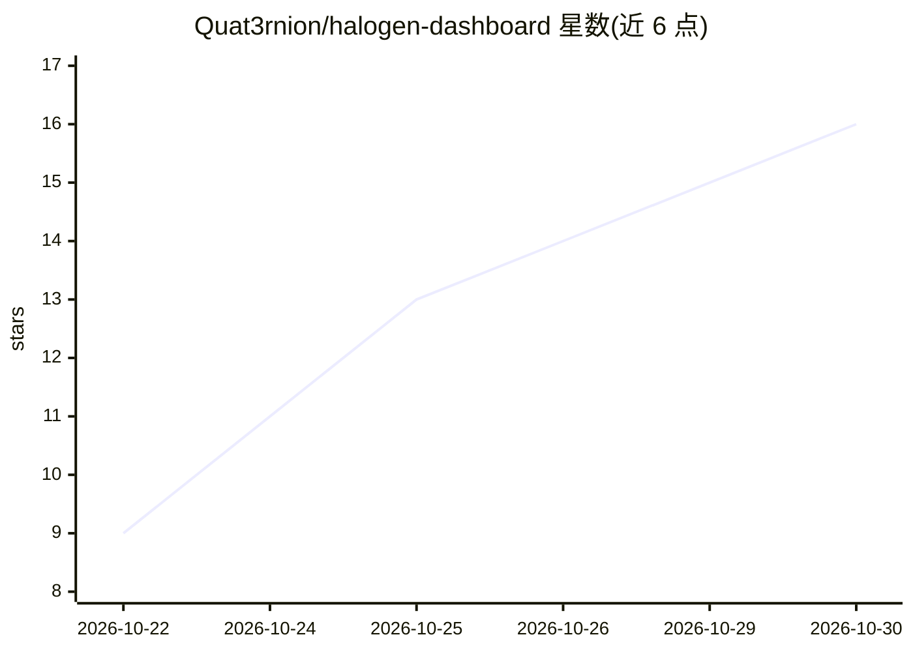

# Quat3rnion/halogen-dashboard

⭐ 16 · Rust · Apache-2.0 · 推送 2026-10-20 · [GitHub](https://github.com/Quat3rnion/halogen-dashboard) · 个人维护

**Halogen LLM 推理服务器的实时监控仪表盘**

针对 Halogen LLM 推理服务器（基于 metrics 接口）的实时监控看板：单一 Rust 进程（Collector）每秒读取 Halogen 的 /metrics，历史数据存入 SQLite 并推送到 Web 页面。展示状态与停机原因、生成速度、吞吐、Busy Slots、KV pool 使用率、prompt-cache 命中率等指标，支持 Live 到 30 天的多个时间范围、明暗主题与手机视图。限制：Collector 必须是 Halogen /metrics 的唯一读取方，不可同时添加 Prometheus 直接抓取 Halogen。以 Docker Compose 方式部署，附带 fake-halogen 模拟器用于演示。

## 筛选速览

| 维度 | 判定 | 备注 |
|---|---|---|
| AI 角色 | `ai-ecosystem` | LLM/agent 周边工具 |
| 许可风险 | `permissive` | Apache-2.0 |
| 部署形态 | `self-host` | docker 或自建部署 |
| 模型依赖 | — | README 未给出锁定关系 |
| 硬件要求 | — | 无带数字的原话,不猜 |
| 安装摩擦 | `low` | 无编译、无系统依赖或容器化 |
| 成熟度 | — | 结构信号不足 |

## 能力要点

- Rust Collector 每秒读取 Halogen /metrics，SQLite 存储历史
- 覆盖状态/吞吐/生成速度/KV pool/缓存命中率等推理指标
- 7 档时间范围，停机显示为图表间隙、重启显示为标记
- 内置 fake-halogen 模拟器（可注入停机/重启/劣化事件）

## 适用场景

- 运维人员实时观察 Halogen 推理服务器的负载与健康状态
- 回看过去 24 小时至 30 天的吞吐与停机历史
- 无真实服务器时用模拟器体验仪表盘功能

## 场景标签

`LLM 可观测性` · 领域:评测与运维

## 证据(README 行号)

> L3: A live dashboard for the Halogen LLM inference server. One Rust process (the Collector) reads Halogen each second, k
> L19: - Status (Up, Degraded or Down) with the reason, Uptime, model and version.
> L20: - Generation speed, Throughput, Prefill speed and Prefill throughput.

## 星数曲线

2026-10-22 9 → 2026-10-30 16（+7）

---
*卡片 v1 · prompt 1.4 · 生成 2026-10-30 · 置信度 mid · 依据 README sha `9e63f3172b82` · [字段定义](../../DATASET.md)*
