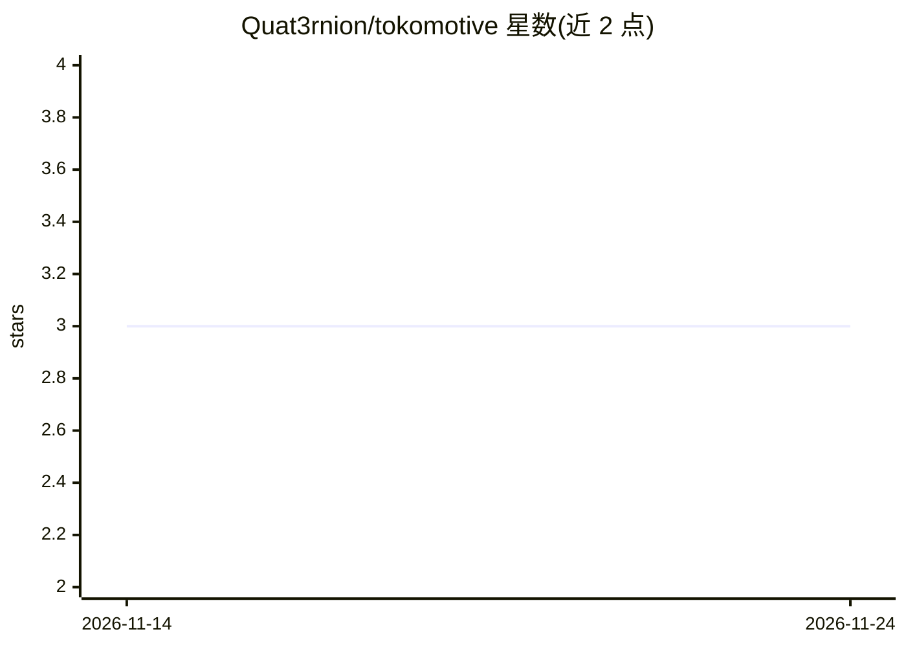

# Quat3rnion/tokomotive

⭐ 3 · Rust · Apache-2.0 · 推送 2026-11-16 · [GitHub](https://github.com/Quat3rnion/tokomotive) · 个人维护

**LLM 路由代理：多部署转发、故障回退与按用户成本记账**

用 Rust 编写的 LLM 路由与代理服务：客户端把请求发给代理，代理按 priority/round_robin/weighted 策略选择部署并转发，读取响应中的 token 用量；Full Mode 下记录每个用户与模型的 Cost、Price 和 Profit。提供 Web 仪表盘配置、故障回退与熔断、OpenAI 与 Anthropic 格式互译、响应缓存、Guardrails、预算与限流，全部配置存库并可热更新。安装方式为 Docker Compose 或 Cargo（Rust 1.88+）。

## 筛选速览

| 维度 | 判定 | 备注 |
|---|---|---|
| AI 角色 | `ai-ecosystem` | LLM/agent 周边工具 |
| 许可风险 | `permissive` | Apache-2.0 |
| 部署形态 | `self-host` | docker 或自建部署 |
| 模型依赖 | locked-api |  |
| 硬件要求 | — | 无带数字的原话,不猜 |
| 安装摩擦 | `low` | 无编译、无系统依赖或容器化 |
| 成熟度 | — | 结构信号不足 |

## 能力要点

- 按策略选择部署，失败时回退并带熔断与探活
- OpenAI 与 Anthropic API 双向格式翻译，支持流式与工具
- 七类 token 记账、Cost/Price 卡片、用户/团队预算与限流
- 加密精确缓存与可选语义缓存、Guardrails 规则、MCP 网关

## 适用场景

- 多模型部署下做统一路由与故障回退
- 按用户/团队统计并限制 LLM 花费
- 让 OpenAI 客户端调用 Anthropic 上游（或反之）
- 对提示词与响应做 PII/敏感信息拦截与脱敏

## 场景标签

`模型网关` · 领域:Agent 开发

## 证据(README 行号)

> L5: Tokomotive is an LLM router and Proxy with optional cost accounting. Clients
> L56: - Supports OpenAI-compatible APIs (`/v1/chat/completions`, `/v1/responses`,
> L58:  Anthropic API (`/v1/messages`), with and without streaming.

## 星数曲线

2026-11-14 3 → 2026-11-24 3（+0）

---
*卡片 v1 · prompt 1.4 · 生成 2026-11-22 · 置信度 high · 依据 README sha `4af87cb44739` · [字段定义](../../DATASET.md)*
